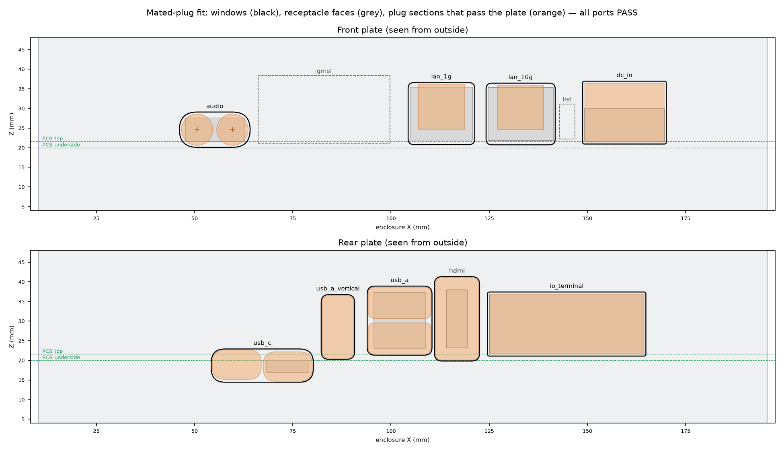

<h1 align="center">J501 AGX Orin Enclosure</h1>

<p align="center">
  A 3D-printable housing for the <a href="https://www.seeedstudio.com/reServer-Industrial-J501-Carrier-board-for-Jetson-AGX-Orin-p-5950.html">Seeed reServer Industrial J501 carrier board</a>
  with an NVIDIA Jetson AGX Orin module.<br>
  <b>Rev 0.9 · fit-check prototype</b> · fits a 256 mm printer bed · MIT licensed
</p>

<p align="center">
  
</p>


**Download:** Rev 0.9 is a candidate on `main` and is not tagged yet: print it from [`exports/`](exports/README.md). Tagged releases (all STL files, assembly instructions and renders in one zip) are on the [releases page](https://github.com/mvalancy/j501-agx-orin/releases).

**Browse the parts:** the [print index](exports/README.md) shows every part with a picture, its size, a 3D view and download links. Every folder has a README with pictures.

**Status:** the Rev 0.8 base, plates and cover have been printed and test-fitted. The base and plates fit; the Rev 0.8 cover hit the cooler by about 15 mm, because it was sized for a lower 34 mm cooler. Rev 0.9 is built around that cooler: see the [cooler fit review](docs/cooler-fit-review.md) for the model and the clearance checks (the lid clears the fan even if its true position is 3 mm off the photo estimate). Rev 0.9 also raises the cooler tie-down seats in the base by 1.5 mm, so the M3 × 35 screws catch 6 threads in this cooler's standoffs (a Rev 0.8 base gives about 3). Its cover and base are checked in CAD and simulation only, so print the test parts first.

**You need:** a [Seeed reServer Industrial J501 carrier](https://www.seeedstudio.com/reServer-Industrial-J501-Carrier-board-for-Jetson-AGX-Orin-p-5950.html), a Jetson AGX Orin module, and a cooler. The optional [GMSL extension board](https://www.seeedstudio.com/reServer-Industrial-J501-GMSL-extension-board-p-5949.html) is supported. The cooler is Seeed's [reComputer mini J501 heatsink with fan](https://www.seeedstudio.com/reComputer-Mini-J501-heatsink-with-fan-p-6605.html) (110 × 100 × 50 mm: a 2 mm copper spreader, a five-heat-pipe tower and a 92 × 15 mm, 12 V fan). Seeed's lower [34 mm heatsink with fan](https://www.seeedstudio.com/Aluminum-heatsink-with-Fan-for-Jetson-AGX-Orin-p-5970.html) fits the Rev 0.8 cover instead. Port details are on the [Seeed wiki](https://wiki.seeedstudio.com/j501_carrier_board_interfaces_usage/); everything else is at [seeedstudio.com](https://www.seeedstudio.com/).

**Contents:** [Printed parts](#printed-parts) · [Hardware to buy](#hardware-to-buy) · [Assembly guide](ASSEMBLY.md) · [Design notes](#design-notes) · [Reproduce](#reproduce) · [Project folders](#project-folders)

## Bill of materials

Every printed part has a [3MF](exports/) (opens in Bambu Studio), STL and STEP file in [`exports/`](exports/). The full BOM with dimensions is [docs/BOM.csv](docs/BOM.csv).

### Printed parts

**Enclosure** (pick one base and one front plate):

| Part | File | Qty | When | Print face down |
|---|---|---|---|---|
| P1 Base | [base.3mf](exports/base.3mf) | 1 | Desktop, or any setup with drive trays | Floor |
| P1M Base with mounting tabs | [base_mount.3mf](exports/base_mount.3mf) | 1 | Wall or robot mount without drive trays | Floor |
| P2 Cover | [cover.3mf](exports/cover.3mf) | 1 | Always | Roof |
| P3 Front plate, GMSL | [front_gmsl.3mf](exports/front_gmsl.3mf) | 1 | GMSL board fitted | Outside face |
| P4 Front plate | [front_no_gmsl.3mf](exports/front_no_gmsl.3mf) | 1 | No GMSL board | Outside face |
| P5 Rear plate | [rear_io.3mf](exports/rear_io.3mf) | 1 | Always | Outside face |
| P10 Side hatch | [side_hatch.3mf](exports/side_hatch.3mf) | 1 | Always | Outside face |
| P18 Floor cap | [chimney_cap.3mf](exports/chimney_cap.3mf) | 1 | No drive trays | Flange |

**Drive storage** (optional; stack 1 tray, 1 of each, or 2 of each, in any order):

| Part | File | Qty | When |
|---|---|---|---|
| P15 3.5 in tray | [storage_35.3mf](exports/storage_35.3mf) | 0–2 | One 3.5 in drive each |
| P16 2.5 in tray | [storage_25.3mf](exports/storage_25.3mf) | 0–2 | Two 2.5 in drives each, up to 15 mm thick |
| P17 Mounting plate | [storage_mount_plate.3mf](exports/storage_mount_plate.3mf) | 1 | Wall or robot mount with drive trays |
| P19 SSD clip | [ssd_clip.3mf](exports/ssd_clip.3mf) | 4 per drive | 7 mm SSDs with no bottom screw holes |

**Test prints** (print these first, in your filament):

| Part | File | Checks |
|---|---|---|
| P9 Fit template | [mount_fit_template.3mf](exports/mount_fit_template.3mf) | The bare board sits flat on all its supports, and the cooler holes line up |
| P11 Insert coupon | [m3_insert_coupon.3mf](exports/m3_insert_coupon.3mf) | Which pilot hole (3.7–4.1 mm) holds an M3 insert |
| P12 / P13 Rail coupon and key | [rail_coupon.3mf](exports/rail_coupon.3mf), [rail_key.3mf](exports/rail_key.3mf) | Plates slide in their channels without rattling |
| P14 Countersink coupon | [countersink_coupon.3mf](exports/countersink_coupon.3mf) | The M3 × 35 flat head seats on its cone |
| P20 Antenna hole coupon | [rpsma_coupon.3mf](exports/rpsma_coupon.3mf) | Which D-hole flat (5.9–6.2 mm) holds an RP-SMA bulkhead without turning |

Filament is not specified yet, so fits, heat resistance and insert retention are untested.

**Already printed the Rev 0.8 cover?** It fits the 34 mm cooler. To use it over the 50 mm reComputer mini J501
cooler, print the one-off 18 mm riser from `tools/lid_riser.py --rise 18 --slice` (49 g, 1 h 41 min, files in
`build/print/`). It goes between the base and the cover, and the lid then takes 4 × M3 × 30 screws instead of M3 × 16.
The riser is a recovery part, not part of the release set. A thicker 92 × 25 mm fan on this cooler needs `--rise 10`
on the Rev 0.9 cover, with screws 10 mm longer.

### Hardware to buy

**Enclosure:**

| Item | Qty | Used for |
|---|---|---|
| M3 × 10 heat-set insert | 8 | Board supports (4) and lid columns (4) |
| M3 × 10 button head, ISO 7380 | 4 | Board to base |
| M3 × 35 flat head, DIN 7991 / ISO 10642 | 4 | Cooler tie-down, up through the floor |
| M3 × 16 socket head, ISO 4762 | 4 | Lid, from the top (2.5 mm hex key, 40 mm reach) |
| RP-SMA female bulkhead pigtail, to U.FL or MHF4 | 0–4 | Antennas: 2 Wi-Fi, 2 cellular |
| Rubber bumper, up to Ø12 × 1 mm | 4 | Desktop feet, optional |
| M6 screws and Ø16 washers | 4 | P1M wall or robot mount; length depends on the surface |
| SIM eject pin or paper clip, Ø1.2 mm or less | 1 | Pressing the reset and recovery buttons |

**Drive storage:**

| Item | Qty | Used for |
|---|---|---|
| M3 × 10 heat-set insert | 4 | Base column feet |
| M3 male-female hex standoff, 5.5 mm across flats, 6 mm male | 4 per tray | M3 × 30 for P15, M3 × 20 for P16 |
| 6-32 UNC × 3/16 in pan head | 4–6 per 3.5 in drive | Drive to tray |
| M3 × 4 button head | 4 per 2.5 in drive | Drive to tray |
| M3 × 5 button head, M3 × 6 button head, M3 nut | 4 of each per clipped SSD | P19 clips |
| M3 × 6 button head | 4 | Close the bottom tray (without P17) |
| M3 × 12 socket head | 4 | P17 to the bottom tray (instead of the M3 × 6) |
| SATA data cable, straight plug, slim or foldable, 300–450 mm | 1 per drive | Board to drive |
| JST PH 2.0 4-pin to SATA power lead | 1 per 2.5 in drive | Board 5 V to the drive. Check the pinout first |
| 12 V supply for a 3.5 in drive: Ø8 mm panel DC jack and 12 V-to-SATA adapter | 1 per 3.5 in drive | The board only supplies 5 V to drives |

## Assembly

**Illustrated step-by-step guide: [ASSEMBLY.md](ASSEMBLY.md).** Each step has a picture with the new parts in orange.

[](ASSEMBLY.md#3-heat-set-the-inserts)

1. Print the test parts (P9, P11–P14, P20) and test-fit the bare board on P9.
2. Heat-set 8 × M3 inserts: 4 board supports, 4 lid columns.
3. Fit the board (4 × M3 × 10). Without drive trays, plug the floor opening with P18.
4. Fit the module and cooler, then tie the cooler down with 4 × M3 × 35 flat heads from below.
5. Fit the antennas, slide in the plates and hatch, and fit the lid (4 × M3 × 16).
6. Drive trays (optional): inserts in the base feet, drives into the trays, cables down the chimney, then hang each tray on standoffs.

## Design notes

**Size:** 206 × 181 × 97 mm. With two of each tray the stack is 220 mm tall. The largest print, P1M, is 206 × 233 × 76.5 mm.

**Review material:** `python tools/serve_preview.py` serves the local review site. The engineering tables are in [docs/engineering-review.html](docs/engineering-review.html); the dimensioned paper review is [docs/check-sheet.pdf](docs/check-sheet.pdf).

### Storage expansion and the underside slots

**Underside slots.** The Mini PCIe (J13) and M.2 Key B (J11) slots sit side by side under the front-left of the carrier, and their cards run toward the rear, one above the other. The M.2 Key E (J14) Wi-Fi card runs toward the SATA corner. Card envelopes, including U.FL plugs, are in `cad/parameters.json` under `underside_envelopes`:
- The stacked pair needs at most 10 mm below the PCB; 16 mm is available.
- The stacked pair's envelopes are 6–7 mm above the floor and needed no relief.
- The M.2 E envelope touched a support (74 mm³), which is now relieved with a 0.5 mm margin.

**SATA is on the underside.** The two SATA III receptacles (J21 port 0, J24 port 1) and their JST PH 2.0 4-pin power headers (J22, J23) are *vertical connectors on the underside* (datasheet photo, STEP solids 5061–5064). Cables plug in straight up from below. The base floor has an opening directly beneath them, so the cables drop into the storage trays. P18 plugs the opening when no storage is fitted.

**Power.** The board's SATA power headers carry switched **5 V only**, 2 A per port (schematic sheet 27):
- 2.5 in drives can run from the board.
- 3.5 in drives need 12 V. The 3.5 in tray has an 8 mm **12V IN** hole and tie anchors for a 12 V-to-SATA power adapter.
- Board input is 12–36 V, so DC-IN can only be shared with the drives if your supply is 12 V.

**Trays.** P15 holds one 3.5 in drive (SFF-8301, all three 6-32 hole pairs). P16 holds two 2.5 in drives up to 15 mm (SFF-8201 M3 holes); 7 mm drives without bottom holes need side mounting.

Stack any mix, in any order:
- M3 heat-set inserts go in the four base column feet.
- Each tray is clamped by four M3 male-female hex standoffs: M3 × 30 for P15, M3 × 20 for P16.
- Each standoff's male end clamps the tray's 2 mm ledge to the part above, and its female end receives the next tray.
- Drive connectors face a cable gutter on the left side that runs the full depth of the tray. A chimney lines up through every tray floor.
- P17 replaces P1M for wall or robot mounting under a stack.
- Two of each tray adds 108 mm, for 220 mm overall.
- The board has two SATA ports; more drives need an M.2 Key M SATA adapter or USB.

**Drive mounting.**
- 3.5 in drives use bottom 6-32 screws.
- 2.5 in drives up to 15 mm use bottom M3 screws.
- Skinny 7 mm SSDs that only have side holes use four P19 clips each. Each clip takes an M3 × 5 through its wall into the drive side and an M3 × 6 from under the tray into a captive nut, using the same tray holes.
- Drive connector ends sit at X 48 (3.5 in) and X 62 (2.5 in) to leave room for the cable bend.

**Cable routing.**
- Leads plug straight up into J21–J24, drop through the base floor opening and each tray's chimney, then turn in the left gutter and run straight into the drive plug.
- Assumed minimum bend radii: 12 mm SATA data, 6 mm PH power, 8 mm 12 V. No SATA standard publishes one.
- Wire a 3.5 in drive from the front SATA connector and a 2.5 in drive from the rear one. From the rear connector, the turn into a 3.5 in drive's data plug only allows about a 9 mm bend.
- Every route is modelled and checked for bend radius and plastic clearance.
- A 2D route diagram is at `preview/cable-route-diagram.png`.

`exports/storage-checks.json` covers seven stack combinations. Each passes with no plastic or hardware overlap and an open chimney. It also records the envelope gaps and drive-screw engagement.

### Port windows

Every window is **derived from the mating plug**, placed on the receptacle's measured mating axis
([`cad/ports.py`](cad/ports.py), using `cadagent.connectors`). None is sized from a receptacle bounding box: a bounding
box includes pins below the board, which put the windows about 2 mm low. Each port in `cad/parameters.json` has a
`mate` entry giving:

- the receptacle face (measured by slicing the board model at its mating face);
- the plug model and its source.

The full list is in [docs/cutout-register.csv](docs/cutout-register.csv).

| Port | Mating plug modelled | Window |
|---|---|---|
| DC IN | Phoenix MSTB 2,5/2-STF-5,08 screw-flange plug (Phoenix drawing): 20.17 × 15 mm, 9.9 mm outside the header | Centred on the plug |
| 1GbE, 10GbE | RJ45 plug 11.7 mm wide + latch lever (Panduit/TIA values) | Centred on the jack face, LEDs visible |
| AUDIO | 3.5 mm plugs with D8 overmolds (assumed) on the jack axes | Centred on the two jacks |
| USB-A, USB-C, HDMI | Typical overmolds: 16 × 8 / 12.5 × 7.5 / 21 × 11 mm, rounded (assumed) | Centred on the mouths |
| I/O | The 2 × 10 push-in plug, already mated in the board model | Centred on the plug face |

Front windows have 0.5 mm clearance and rear windows 0.25 mm. Webs narrower than 1.8 mm are bridged.
[`tools/check_ports.py`](tools/check_ports.py) checks each plug by sweeping it in along its axis against the base,
cover and plate. The check passes only with zero overlap, the clearance met all round (corner radii included) and no
plug-to-plug clash. Results are in [exports/port-checks.json](exports/port-checks.json); the evidence image is
[preview/port-fit.png](preview/port-fit.png).

<p align="center"></p>

**Legends:** "DC IN 12-36V" with − / + over the two pins, "1GbE", "10GbE".

> [!WARNING]
> The DC polarity marks are **inferred**. The schematic gives J2 pin 1 = DCJ_IN (12-36 V, through fuse F1) and
> pin 2 = GND. The board model does not show which physical pin is pin 1, so + is placed on the pin next to F1
> (the right-hand pin, seen from the front). Confirm this with a meter before first power-up. If it is the other way
> round, swap the two `marks` in `cad/parameters.json`.

Overmold and boot sizes are typical values; check them against your actual cables.

### Geometry provenance

[docs/connector-inventory.csv](docs/connector-inventory.csv) is a schematic-derived mechanical inventory, not an official BOM.

The carrier STEP contains 5176 solids and 158 open shells. Eight mount proxies and four zero-thickness pseudo-solids are handled as recorded in the reports.

Two source models are not mechanically authoritative:

- **J26:** the source STEP is a 3.81 mm placeholder. A 13.85 mm footprint-height envelope is used instead.
- **Audio:** the STEP library model differs from the schematic part number.

The GMSL XY position, port positions and top-component placement remain provisional. The provisional GMSL PCB top is only 1.58 mm below the cooler seat where they overlap by 4.5 mm; measure this before printing P3. Sources are listed in [references/sources.json](references/sources.json).

### Coordinates

All units are millimeters. In the carrier frame, X starts at the left PCB edge, Y at the front edge and Z at the PCB underside.

- Convert source STEP coordinates by subtracting `(32.199, -510.506, -1.578)`, then adding `(15, 15, 20)` to reach the enclosure datum.
- The enclosure outline spans X0–206, Y5.5–186.5, Z0–97, with the split at Z72.
- Key heights: PCB underside Z20 (4 mm floor + 16 mm supports); AGX thermal plate top Z40.758; copper spreader top Z43.258; fan top Z91.558; fan grille underside Z94 (2.44 mm above the fan); roof top Z97.

### Checks (`exports/`)

| Report | Result |
|---|---|
| `geometry-checks.json` | 17 printable parts, each one valid solid, watertight STL |
| `assembly-checks.json`, `mount-checks.json` | 0 mm³ plastic overlap across all part pairs, both front variants and P1M |
| `carrier-clearances.json` | 0 carrier-solid collisions. 0 collisions between plastic and the modeled screws, module, cooler or GMSL. 8 intended insert interferences |
| `shell-clearances.json` | open-shell intrusion check |
| `assembly-paths.json` | plates slide vertically: 0.37 front / 0.25 rear |
| `print-review.json` | downward-face screen. Flagged areas are the 4 mm vent arches, the 12 mm foot-pocket bridges and two 2 mm² groove ends |
| `design-metrics.json` | roof, vents, tie-down, fasteners, mounts |
| `storage-checks.json` | underside card envelopes and gaps, SATA drop, 7 stack configurations, cable routes and bend radii, chimney path, drive-screw engagement |

None of these checks covers slicer validation, insert pullout, thermal performance, vibration, creep under the cooler clamp load, or mounting load capacity.

## Reproduce

Vendor CAD models, datasheets and schematics are not redistributed here. Fetch them from their original URLs,
checksum-verified against `references/sources.json`, and rebuild the caches the build reads:

```bash
python -m venv .venv
.venv/bin/pip install -r requirements.txt
.venv/bin/python tools/fetch_references.py   # NVIDIA module model needs a developer login; the script prints where
```

The project runs on the [`cad-agent`](https://github.com/Valpatel/cad-agent) toolkit, configured by `cad-agent.yaml`. Without the toolkit, run the scripts
listed under `steps:` in that file in order with `.venv/bin/python`.

```bash
.venv/bin/pip install -e <path-to>/cad-agent      # cadagent toolkit
.venv/bin/cad-agent all       # every build step in cad-agent.yaml, 3MF export, checks, report, package
.venv/bin/cad-agent serve     # local preview with STL/3MF/Bambu Studio links
```

`cad-agent check` gives a pass/fail table of every part, print file, design check and review-page link.
`docs/cad-agent-report.html` is the standalone report.

`cad/parameters.json` is the parameter authority.

### Making a release

`main` is protected: changes go to the `dev` branch, then a pull request from `dev` into `main` (CI's `check` must
pass and every review comment must be resolved).

1. Change the design, set `revision` in `cad/parameters.json` (for example `0.9-...`), and run `cad-agent all`.
2. Commit everything, including `exports/`, push to `dev`, and open a pull request into `main`. CI checks the committed
   print files match that build and pass every check. Merge it once it is reviewed.
3. Tag and push: `git tag rev0.9 && git push origin rev0.9`. CI builds the print zip (STLs, instructions, renders) and publishes the release.

Releases stay marked pre-release until `physical_fit_verified` is true in `exports/review-validation.json`. Every push also leaves the print zip as a downloadable CI artifact for 30 days.

## Project folders

Every folder has a README with pictures, linked back up to this page.

<!-- FOLDERS: written by tools/write_readmes.py -->

| Folder | What is in it |
|---|---|
| [`exports/`](exports/) | Print files: every part with a picture, size, 3D view and downloads |
| [`docs/`](docs/) | BOM, check sheets, measurement and review tables |
| [`preview/`](preview/) | Every render of the design |
| [`cad/`](cad/) | CadQuery source and the parameter file |
| [`tools/`](tools/) | Check, render, documentation and release scripts |
| [`references/`](references/) | Vendor sources and the measurements taken from them |
| [`archive/`](archive/) | Earlier revisions |
| [`.github/workflows/`](.github/workflows/) | CI: checks the print files and publishes releases |

<!-- /FOLDERS -->

## License

MIT (see `LICENSE`) for the enclosure design, source and generated files in this repository. Vendor files fetched
by `tools/fetch_references.py` stay under their owners' terms and are not covered.
