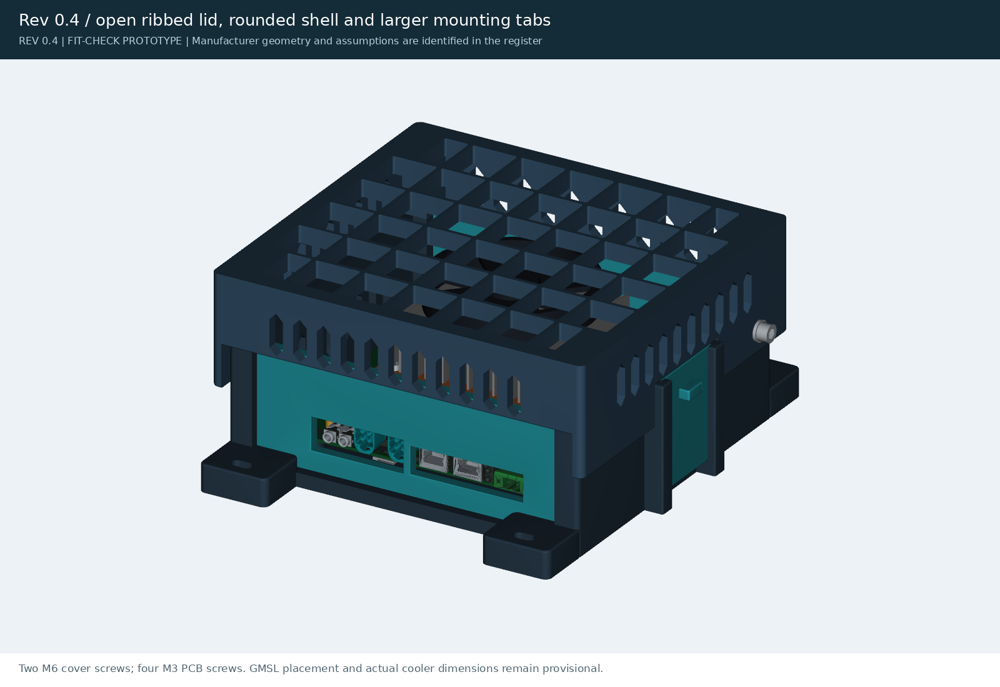
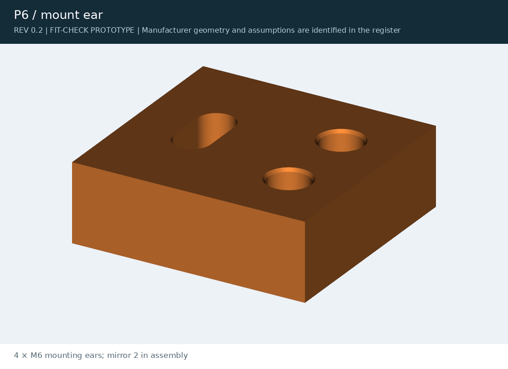

[J501 AGX Orin](../README.md) / **archive**

# Archive

Earlier revisions of the design, kept for reference. **Don't print these:** the current parts are in [`exports/`](../exports/).
Each folder holds that revision's source and parameters; the scripts expect the repository layout of their time and won't run as-is.

<table>
<tr>
<td width="33%" valign="top"> <b><a href="rev04/">Rev 0.4</a></b>: open ribbed lid, rounded shell, larger mounting tabs</td>
<td width="33%" valign="top"> <b><a href="rev02/">Rev 0.2</a></b>: first fit-check build, separate mounting ears and desktop feet</td>
<td width="33%"></td>
</tr>
</table>

| Revision | Folder | What changed |
|---|---|---|
| 0.6 | (current) | Flush shell, framed I/O plates, hex roof, cooler tie-down columns, stackable drive trays |
| 0.4 | [`rev04/`](rev04/) | Open ribbed lid, rounded shell, larger mounting tabs, M6 inserts |
| 0.3 | [`rev03/`](rev03/) | Print-review pass: rail coupon and key, vents. Source and parameters only |
| 0.2 | [`rev02/`](rev02/) | First fit-check build: separate mounting ears (P6) and desktop feet (P7) |

## Folders

| Folder | What is in it |
|---|---|
| [`rev02/`](rev02/) | Rev 0.2, first fit-check build |
| [`rev03/`](rev03/) | Rev 0.3, print review |
| [`rev04/`](rev04/) | Rev 0.4, open ribbed lid |
