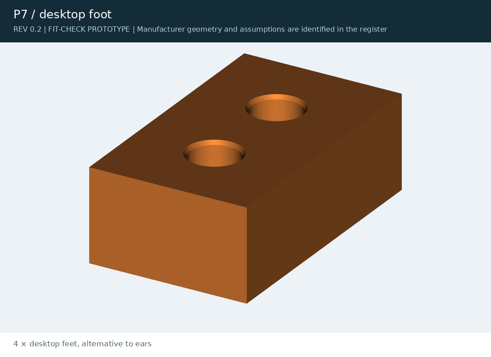

[J501 AGX Orin](../../../README.md) / [archive](../../) / [rev02](../) / **exports**

# Rev 0.2 print files

Superseded parts, kept for reference. The current print files are in [`exports/`](../../../exports/).

<table>
<tr>
<td width="50%" valign="top"> <b>P6</b> mounting ear: <a href="mount_ear.stl">STL</a> · <a href="mount_ear.step?raw=true">STEP</a></td>
<td width="50%" valign="top"> <b>P7</b> desktop foot: <a href="desktop_foot.stl">STL</a> · <a href="desktop_foot.step?raw=true">STEP</a></td>
</tr>
</table>
