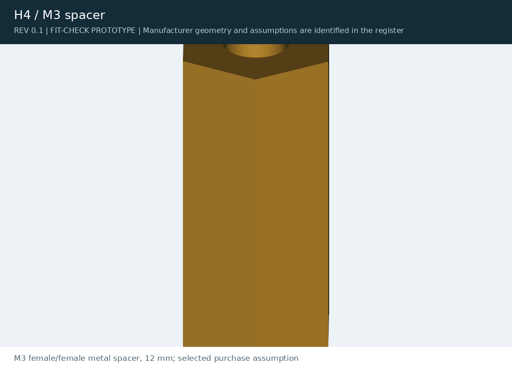
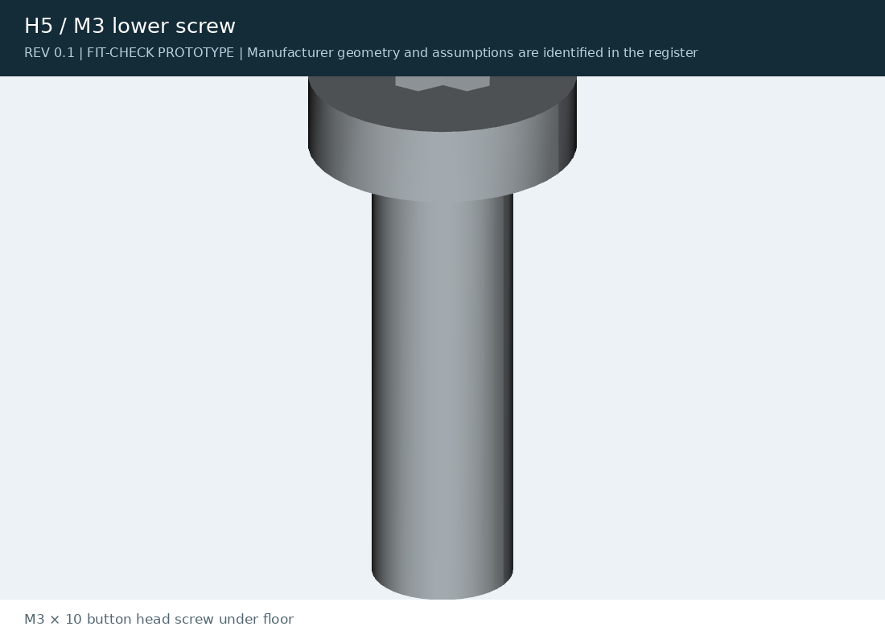
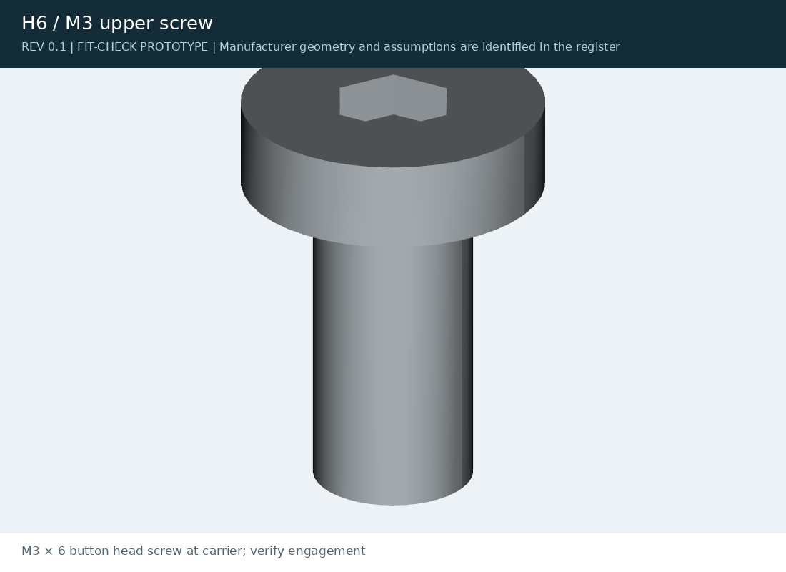

[J501 AGX Orin](../../../README.md) / [archive](../../) / [rev02](../) / **preview**

# Rev 0.2 renders

<table>
<tr>
<td width="33%" valign="top"> <b>P6</b> mounting ear</td>
<td width="33%" valign="top"> <b>P7</b> desktop foot</td>
<td width="33%" valign="top"> <b>H4</b> M3 × 12 spacer</td>
</tr>
<tr>
<td width="33%" valign="top"> <b>H5</b> M3 × 10 screw under the floor</td>
<td width="33%" valign="top"> <b>H6</b> M3 × 6 screw at the carrier</td>
<td width="33%"></td>
</tr>
</table>
