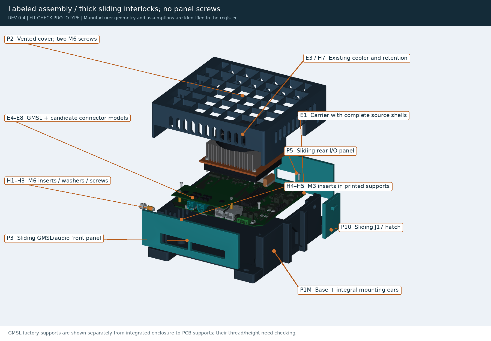
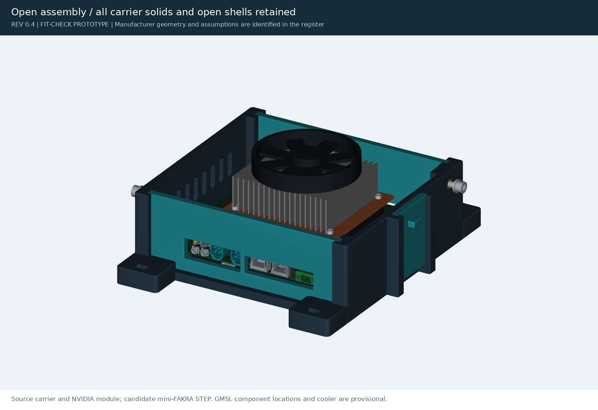

# Rev 0.4: open ribbed lid

An open ribbed lid, a rounded shell and larger mounting tabs held with M6 inserts. Superseded by Rev 0.6, which has a flush shell, a hex
roof, cooler tie-down columns and drive trays. The current parts are in [`exports/`](../../exports/).

<table>
<tr>
<td width="33%" valign="top"> <b>Assembled</b></td>
<td width="33%" valign="top"> <b>Exploded</b></td>
<td width="33%" valign="top"> <b>Open</b></td>
</tr>
</table>

| File | What it is |
|---|---|
| [`parameters.json`](parameters.json) | Rev 0.4 dimensions |
| [`build.py`](build.py), [`hardware.py`](hardware.py) | Rev 0.4 source |
| `assembly_paths.py`, `check_*.py`, `design_metrics.py`, `render.py`, `write_docs.py` | The Rev 0.4 versions of the [`tools/`](../../tools/) scripts |
| [`exports/`](exports/) | Rev 0.4 check results, the insert coupon and the Rev 0.3 and 0.4 review zips |
| [`preview/`](preview/) | All the Rev 0.4 renders |
