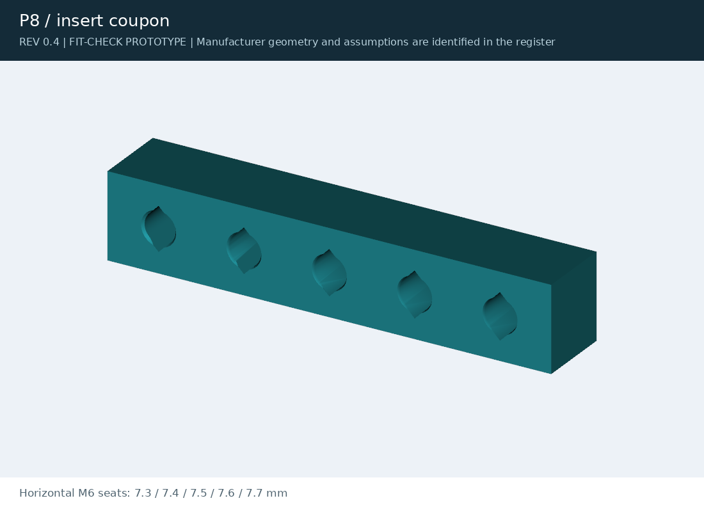

# Rev 0.4 exports

Rev 0.4 check results and review packages, kept for reference. The current print files are in [`exports/`](../../../exports/).

<table>
<tr>
<td width="50%" valign="top"> <b>Insert coupon</b> (Rev 0.4): <a href="insert_coupon.stl">STL</a> · <a href="insert_coupon.step?raw=true">STEP</a></td>
<td width="50%"></td>
</tr>
</table>

| File | What it is |
|---|---|
| `j501-agx-rev03-fit-check.zip`, `j501-agx-rev04-fit-check.zip` | The Rev 0.3 and Rev 0.4 review packages |
| `review-package-manifest.json` | sha256 of every file in the Rev 0.4 package |
| `review-validation.json` | Pass or fail for every Rev 0.4 check |
| `geometry-checks.json`, `print-review.json` | Per-part geometry and printability checks |
| `assembly-checks.json`, `assembly-paths.json`, `mount-checks.json` | Assembly order, insertion paths, mounting tabs |
| `carrier-clearances.json`, `shell-clearances.json` | Clearances to the board |
| `design-metrics.json` | Measured dimensions and design calculations |
