[J501 AGX Orin](../../README.md) / [docs](../) / **assembly**

# Assembly step pictures

The pictures for [ASSEMBLY.md](../../ASSEMBLY.md), drawn by [`tools/render_steps.py`](../../tools/render_steps.py). In each one the parts
added in that step are **orange** and everything already built is grey. Click a picture to read that step.

<table>
<tr>
<td width="33%" valign="top"><a href="../../ASSEMBLY.md#1-print-the-test-parts">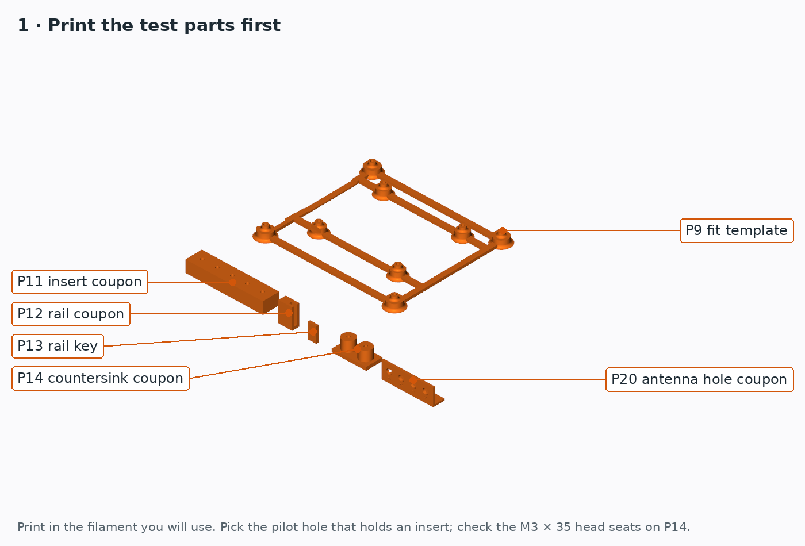</a> <b>1. Print the test parts</b></td>
<td width="33%" valign="top"><a href="../../ASSEMBLY.md#2-test-fit-the-board-on-p9">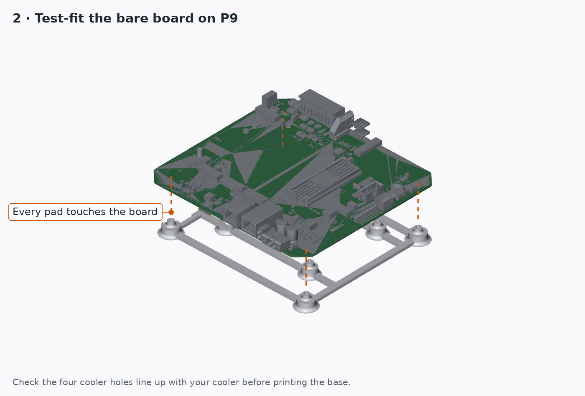</a> <b>2. Test-fit the board on P9</b></td>
<td width="33%" valign="top"><a href="../../ASSEMBLY.md#3-heat-set-the-inserts">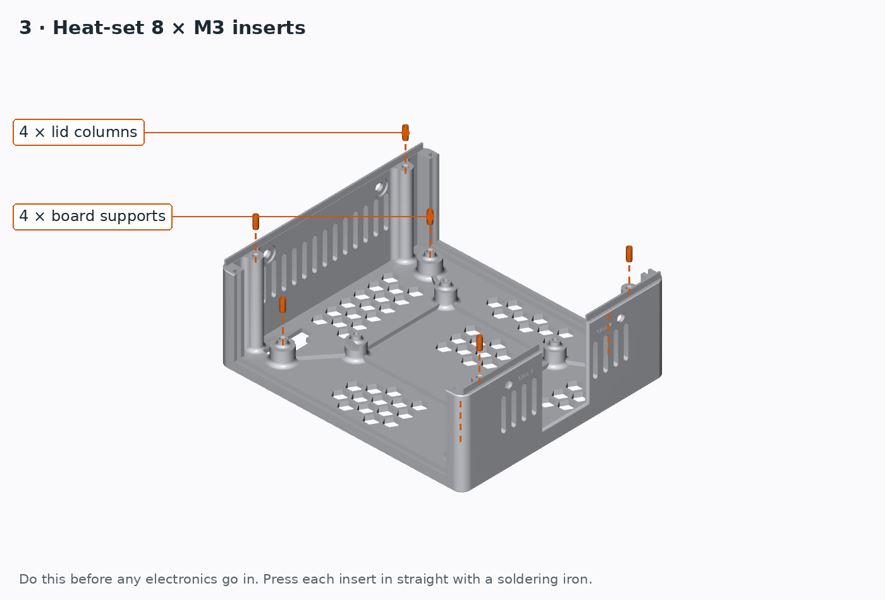</a> <b>3. Heat-set the inserts</b></td>
</tr>
<tr>
<td width="33%" valign="top"><a href="../../ASSEMBLY.md#4-fit-the-board">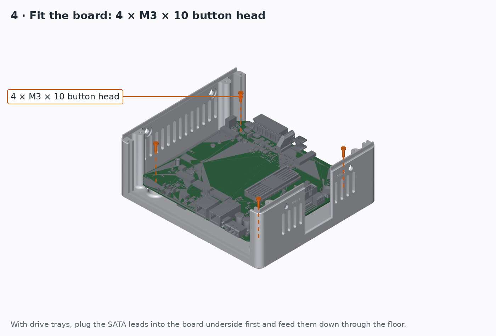</a> <b>4. Fit the board</b></td>
<td width="33%" valign="top"><a href="../../ASSEMBLY.md#4-fit-the-board">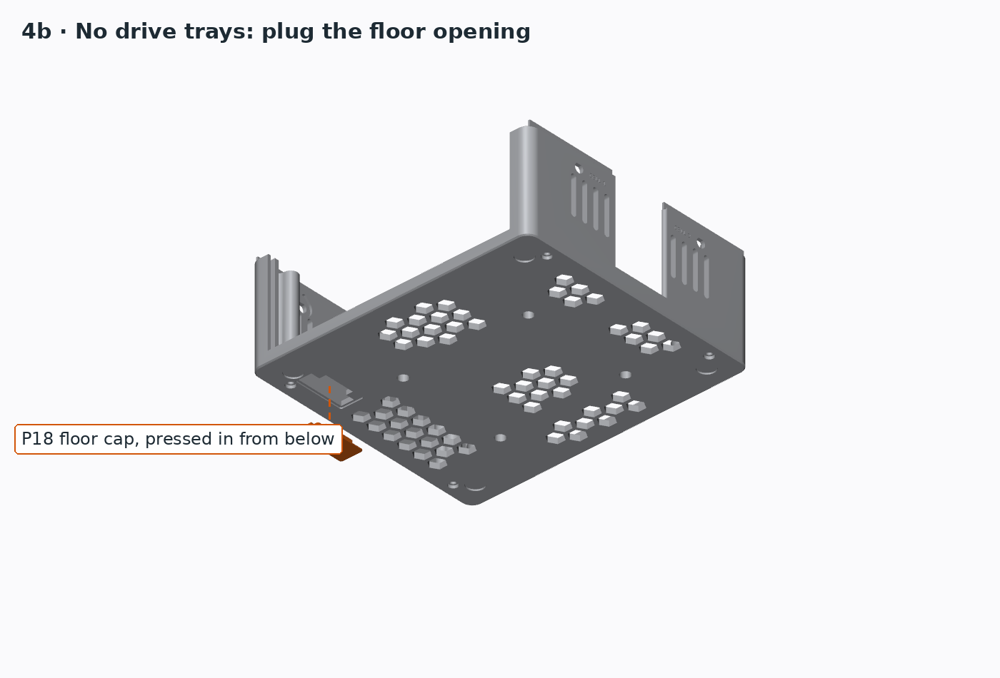</a> <b>4. Floor cap (no drive trays)</b></td>
<td width="33%" valign="top"><a href="../../ASSEMBLY.md#5-fit-the-module-and-cooler">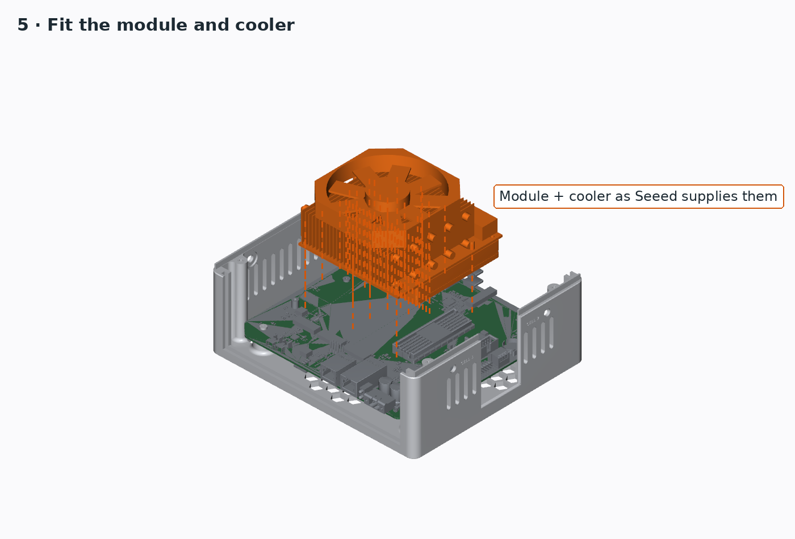</a> <b>5. Fit the module and cooler</b></td>
</tr>
<tr>
<td width="33%" valign="top"><a href="../../ASSEMBLY.md#6-tie-the-cooler-down">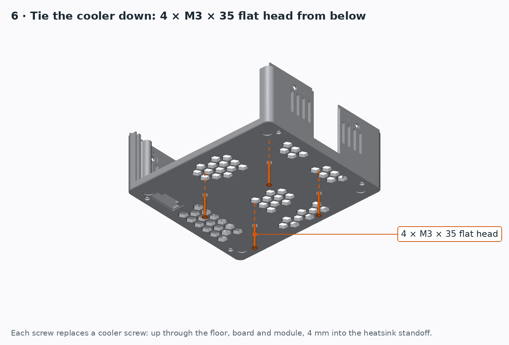</a> <b>6. Tie the cooler down</b></td>
<td width="33%" valign="top"><a href="../../ASSEMBLY.md#7-fit-the-antennas">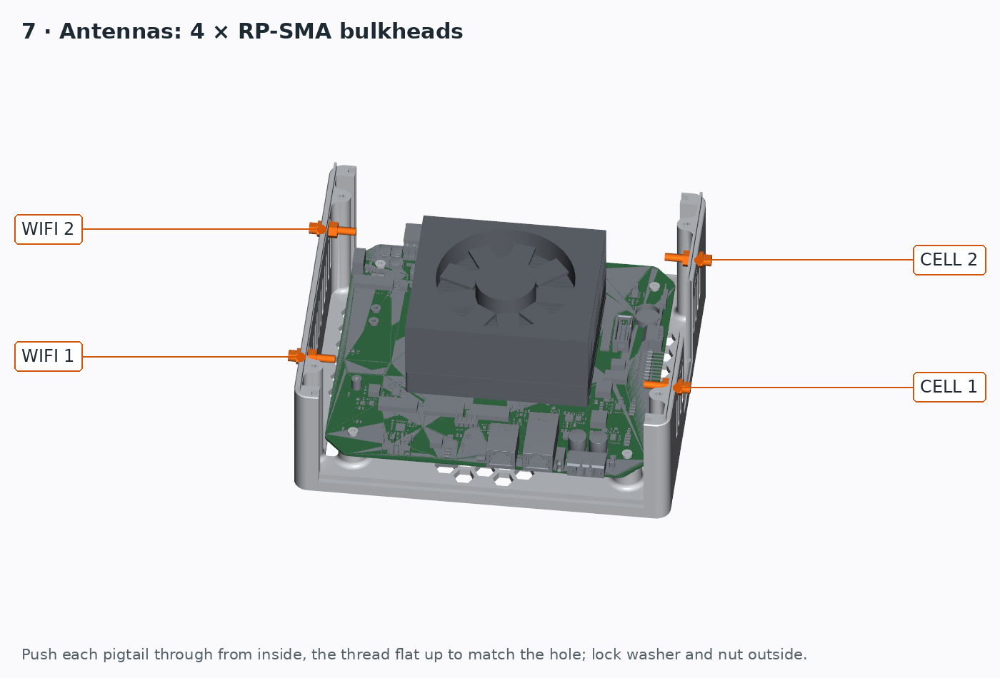</a> <b>7. Fit the antennas</b></td>
<td width="33%" valign="top"><a href="../../ASSEMBLY.md#8-slide-in-the-plates">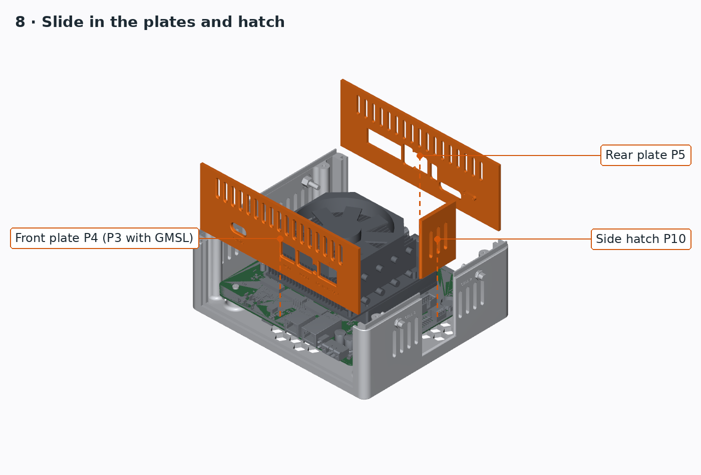</a> <b>8. Slide in the plates</b></td>
</tr>
<tr>
<td width="33%" valign="top"><a href="../../ASSEMBLY.md#9-fit-the-lid">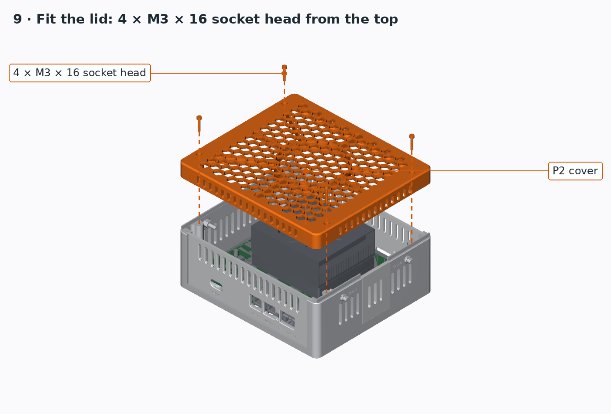</a> <b>9. Fit the lid</b></td>
<td width="33%" valign="top"><a href="../../ASSEMBLY.md#trays-1-inserts-in-the-base-feet">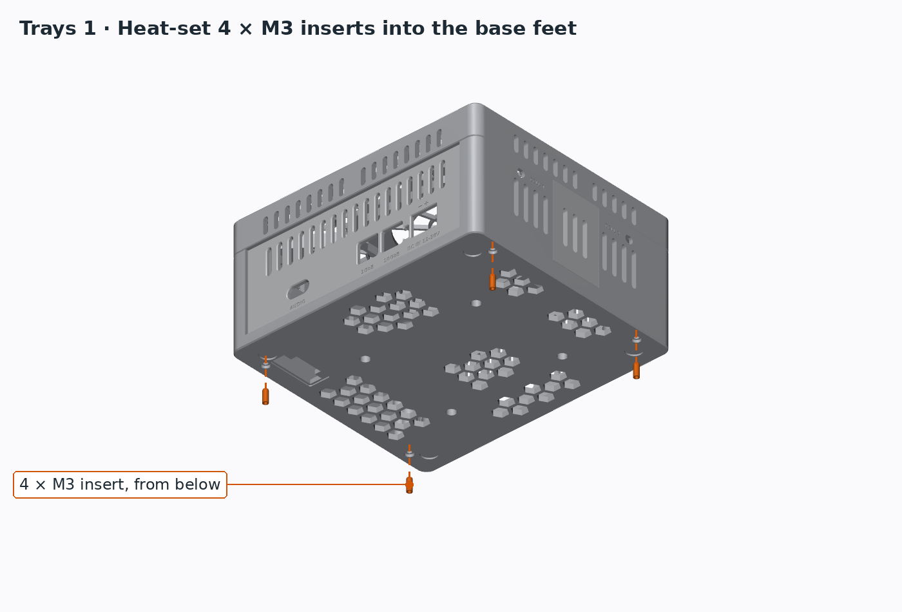</a> <b>Trays 1. Inserts in the base feet</b></td>
<td width="33%" valign="top"><a href="../../ASSEMBLY.md#trays-2-drives-into-the-tray">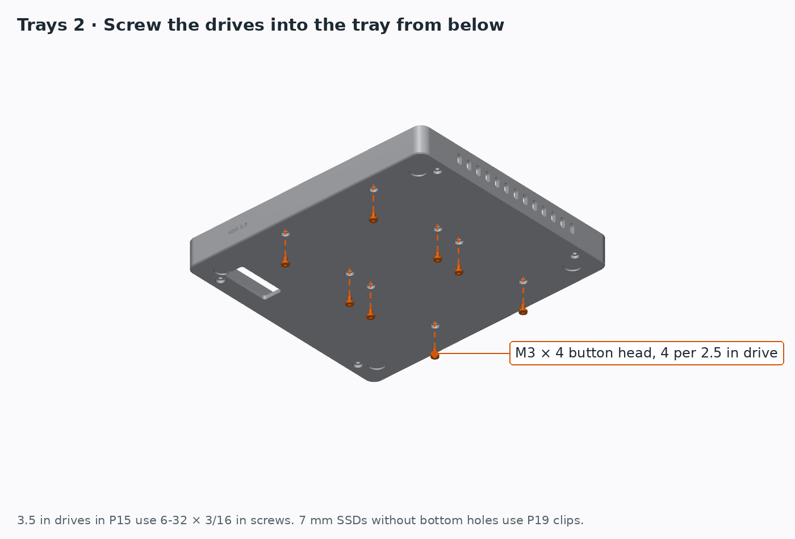</a> <b>Trays 2. Drives into the tray</b></td>
</tr>
<tr>
<td width="33%" valign="top"><a href="../../ASSEMBLY.md#trays-4-hang-the-tray">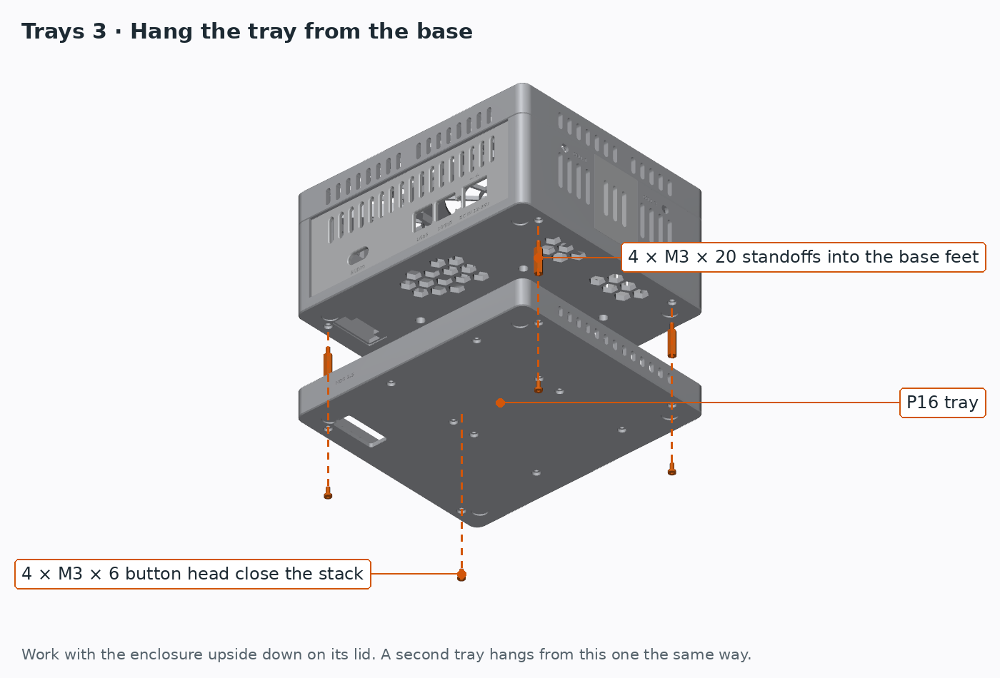</a> <b>Trays 4. Hang the tray</b></td>
<td width="33%" valign="top"><a href="../../ASSEMBLY.md#trays-5-wall-or-robot-mount">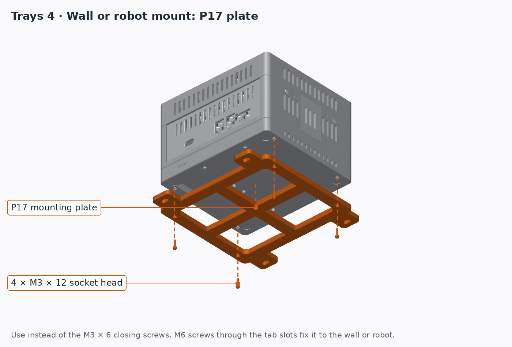</a> <b>Trays 5. Wall or robot mount</b></td>
<td width="33%"></td>
</tr>
</table>
