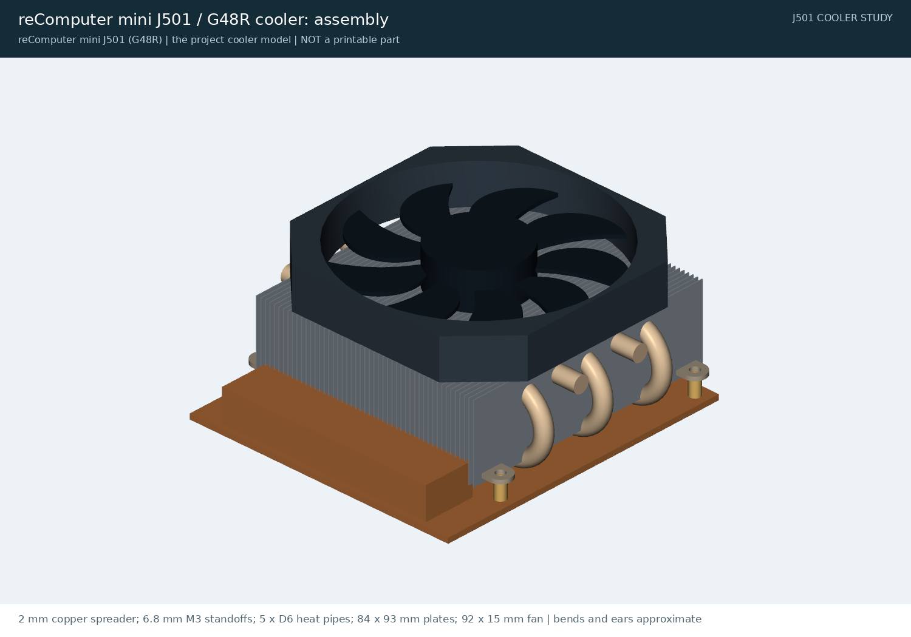
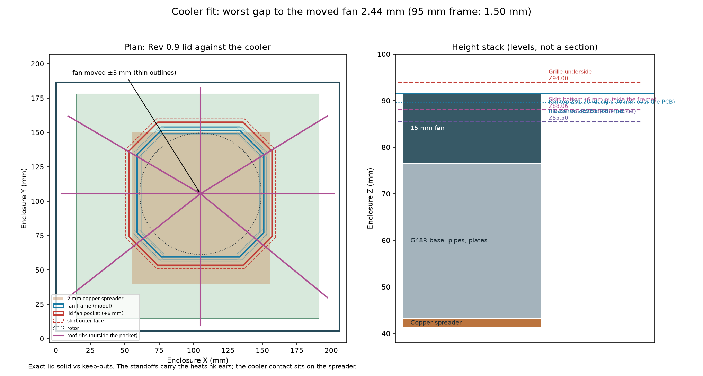
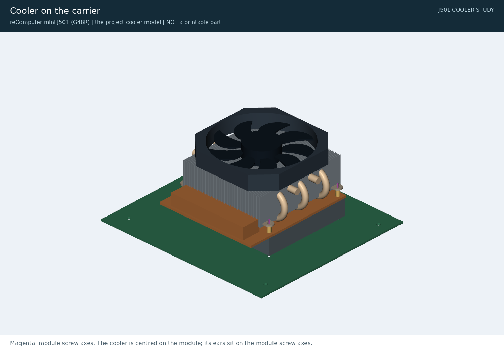
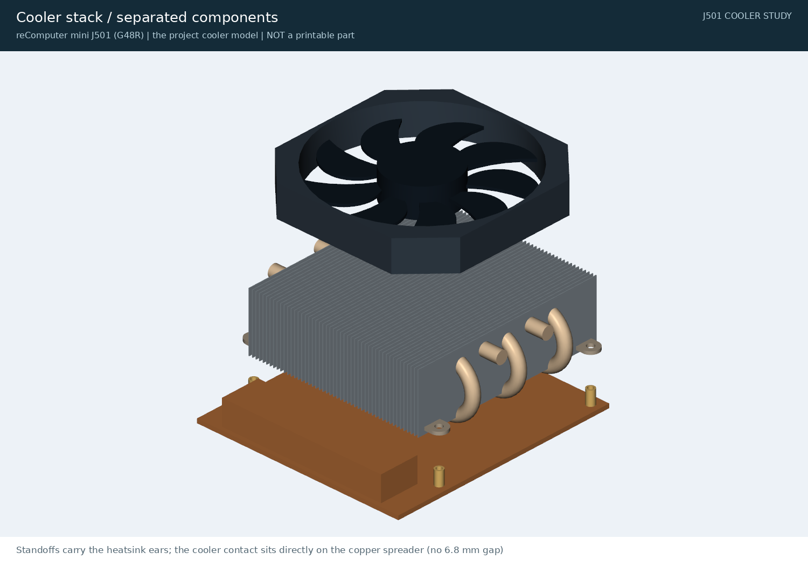

# Cooler fit review: reComputer mini J501 (G48R)

The cooler in the October 27 photographs is Seeed's [reComputer mini J501 heatsink with fan](https://www.seeedstudio.com/reComputer-Mini-J501-heatsink-with-fan-p-6605.html) (SKU 100099421): a 2 mm copper spreader, a G48R heat-pipe tower and a 92 × 15 mm fan, 50.3 mm tall. The Rev 0.8 lid was sized for the lower 34 mm WS-RDN-601 and hit it. Rev 0.9 is built around it. This page is the evidence: the model, where its numbers come from, and exact lid-against-cooler checks.



## One model

`cooler_and_module()` in [cad/hardware.py](../cad/hardware.py) is the only cooler geometry. Renders, the carrier clearance checks, the project 3D viewer and this study all use it. The CFD (`tools/thermal.py`) builds a simplified version from the same parameters: a shell, a porous fin block and an actuator-disc fan. Its dimensions are in the `cooler` section of [cad/parameters.json](../cad/parameters.json). [cad/cooler_reference.py](../cad/cooler_reference.py) only groups it into components for the study. The study began as a separate model ([PR #2](https://github.com/mvalancy/j501-agx-orin/pull/2)) and was merged into this one.

## Placement: centred on the module

The cooler sits **centred on the AGX module** (PCB 90, 90.5). Its four ears sit on the module's four mounting holes, where the long tie-down screws pass.

This comes from a two-plane photo fit of IMG_1852: one plane on the base wall top (Z72), one on the board screw heads (Z24), joined by the straight camera ray. The fit puts the fan hub at PCB (90.4, 90.5). The four ears land within 2.6 mm of the module holes at (44 | 136, 51 | 130).

An earlier fit had the photo **rotated 180°** and put the fan 20 mm toward the front I/O. The front I/O (DC IN, both RJ45, audio) is on the photo's right-hand wall, with DC IN at the top. The mistake showed up because the ears matched the module-hole pitch exactly but landed 20 mm away from the holes.

The same fit gives:

- the copper spreader: 100 × 111 mm, centred at (90.6, 79.8);
- its black finned bar: at the front edge, x 51–130, y 27–46.

## What the lid has to clear



The fit check reads the exact exported lid (`exports/cover.step`). It intersects the lid with two cooler keep-outs: the fan frame, and the heat-pipe and plate block below it. It runs the check with the cooler at its nominal position and moved **3 mm in eight directions**, which is the allowance on the photo placement. It also runs it with the modelled octagonal frame (S06 drawing: about 92 mm) and with the S06 table's 95 mm size, which may include the wire clips.

| Lid | Check | Result |
|---|---|---|
| Rev 0.9 | Fan frame, nominal and moved 3 mm | Clear. The closest point is the grille, 2.44 mm above the fan top (the 70 mm design height). |
| Rev 0.9 | 95 mm frame, moved 3 mm | Clear. The fan pocket is 6 mm outside the frame. |
| Rev 0.9 | Heat-pipe and plate block | Clear by 8.9 mm. |
| Rev 0.8, as printed | Fan frame, nominal | Hits: 14,468 mm³ overlap. This reproduces the collision you saw and is kept as a negative control. |
| Rev 0.8 + 15 mm lift | Fan frame | 0.7 mm. Too tight. |
| Rev 0.8 + 18 mm riser | Fan frame, moved 3 mm | 3.7 mm clear. `tools/lid_riser.py --rise 18` makes the riser; use M3 × 30 lid screws. |

`cad/build.py` runs the same moved-fan check on every build, so a lid change that eats into the margin fails the build. CI re-checks the committed result with `tools/check_cooler_study.py`.

## Height stack

All Z values use the enclosure datum: the PCB underside is at Z20.

| Surface | Z, mm | Basis |
|---|---:|---|
| AGX thermal plate top | 40.758 | PCB and module stack |
| Copper spreader bottom | 41.258 | 0.5 mm thermal pad (assumed) |
| Cooler contact on the spreader | 43.258 | 2 mm copper (user) |
| Plate top / fan bottom | 76.558 | S06: 33.3 mm above the contact |
| Fan top, design | 91.558 | S06: 15 mm fan; 70.0 mm above the PCB top |
| Fan top, measured | about 89.6 | User, October 27: about 68 mm above the PCB top |
| Grille underside, Rev 0.9 | 94.0 | 97 mm lid, 3 mm grille |

The design keeps 70 mm, so the real fan-to-grille gap is about 4.4 mm.

## Mounting stack

The 6.8 mm M3 female-female standoffs stand on the copper spreader at the module holes, under the heatsink ears. Short M3 screws come down through the ears into the standoff tops. The long tie-down screws (H7, M3 × 35 flat head) come up from under the enclosure floor, through the column, the board, the module and the spreader, into the standoff bottoms.

Rev 0.9 raises the countersink seat in the base columns to Z11.26. The screw then has 3 mm (6 threads) in the standoff and leaves 3.8 mm for the short screws. The Rev 0.8 seat counted from the module top, which was right for the 34 mm cooler. With this cooler the same M3 × 35 reaches only about 1.5 mm into the standoff in a Rev 0.8 base.

The cooler's contact face sits directly on the spreader. The standoffs carry the ears and do not raise the whole cooler by 6.8 mm, which would leave an air gap at the thermal contact.

## Sources and approximations

| Source | Used for | Limits |
|---|---|---|
| [S06, Seeed G48R fan/heatsink PDF](https://files.seeedstudio.com/products/NVIDIA-Jetson/reComputer_Mini_J501_Fan.pdf) | 97 × 102 × 48.3 mm with fan; 84 × 93 × 33.3 mm plates; five Ø6 mm pipes; fan frame, Ø88.24 rotor, Ø32.8 hub; 12 V, 4000 rpm | Generic tower drawing, not the Seeed copper adapter |
| S05, Seeed product sheet ([sources](../references/sources.json)) | 110 × 100 × 50 mm kit | Catalogue envelope |
| S03, WS-RDN-601 datasheet | The 100 × 87 × 34 mm alternative | Fits the Rev 0.8 lid and also clears the Rev 0.9 lid; its airflow in Rev 0.9 is not simulated |
| User, October 27 | 2 mm copper; Ø4 × 6.8 mm M3 F-F standoffs; short and long M3 screws; fan top about 68 mm above the PCB | Thread depth and short-screw length not measured |
| IMG_1852–1854 (kept locally) | Placement, octagonal fan frame, spreader outline, finned bar | Perspective; ±3 mm allowance kept |

These shapes are original approximations: the pipe U-bends, the base block, the blade shapes and the mounting ears (`mount_ears_provisional`). They make the model reviewable; they are not machining drawings or an aerodynamic mesh. The S06 drawing frame is about 92 mm, while its table says 95 × 95 × 15 mm; the lid clears both.

## Reproduce

```bash
.venv/bin/python tools/cooler_fit_review.py     # also a cad-agent all step: cooler-study
.venv/bin/python tools/check_cooler_study.py    # CI
cad-agent site --serve                          # top bar: Cooler fit; 3D model (cooler section)
```

- [Assembly STEP](../exports/cooler-study/g48r-reference.step)
- [Component STEP files](../exports/cooler-study/README.md)
- [Fit report (JSON)](../exports/cooler-study/fit-review.json)




