[J501 AGX Orin](../README.md) / **exports**

# Print files

The parts you need to print for the Rev 0.9 enclosure. Click a picture or **3D view** to spin the part in GitHub's
built-in STL viewer, or use the links under it to download the part:

- **3MF** opens in Bambu Studio and other slicers, on a 256 mm plate.
- **STL** works in any slicer.
- **STEP** is for editing in CAD.

STL and 3MF files are already in print orientation. Every part fits a 256 mm bed. Sizes are outside dimensions, largest first.

**One download:** the [release 0.9.1 print page](https://github.com/mvalancy/j501-agx-orin/releases/tag/rev0.9.1): open `index.html` from the zip for every part with its picture, print settings, grams and time, and its STEP, STL and 3MF, plus the assembly guide and the hardware.
**Hardware to buy:** [main README](../README.md#hardware-to-buy). **Build steps:** [ASSEMBLY.md](../ASSEMBLY.md).

  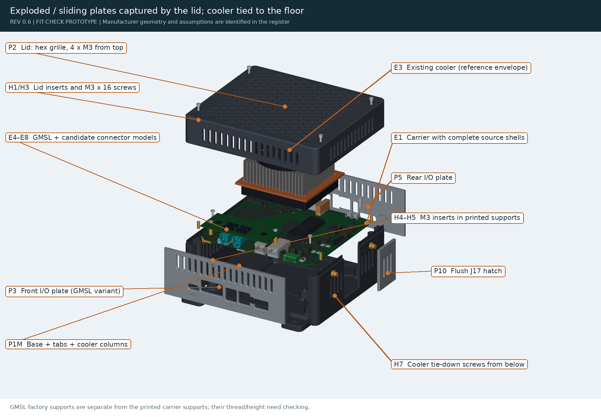

> **Fit-check prototype.** Every part is checked in CAD only and nothing has been printed yet. Print the
> [jigs, fixtures and test coupons](#jigs-fixtures-and-test-coupons) first, in the filament you plan to use.

**Sections:** [Core enclosure](#core-enclosure) · [Mounting and closures](#mounting-and-closures) · [Drive storage](#drive-storage) · [Jigs, fixtures and test coupons](#jigs-fixtures-and-test-coupons) · [Other files](#other-files-in-this-folder)

## What to print for your setup

Every setup needs the cover (P2), the rear plate (P5), the side hatch (P10) and one front plate (P3 or P4). Then add:

| Setup | Base | Mounting and closures | Drive storage |
|---|---|---|---|
| Desktop | P1 | P18 floor cap | none |
| Desktop with drives | P1 | none | P15 and/or P16 trays; P19 clips for side-hole SSDs |
| Wall or robot mount | P1M | P18 floor cap | none |
| Wall or robot mount with drives | P1 | P17 under the stack | P15 and/or P16 trays; P19 clips for side-hole SSDs |

Use the **P3** front plate if you have the GMSL extension board, and **P4** if you don't.

## Core enclosure

Every build needs these, except that P1M (under [Mounting and closures](#mounting-and-closures)) replaces P1 on a wall or robot mount without drive trays. Pick **one** front plate.

<table>
<tr>
<td width="33%" valign="top">
<a href="base.stl">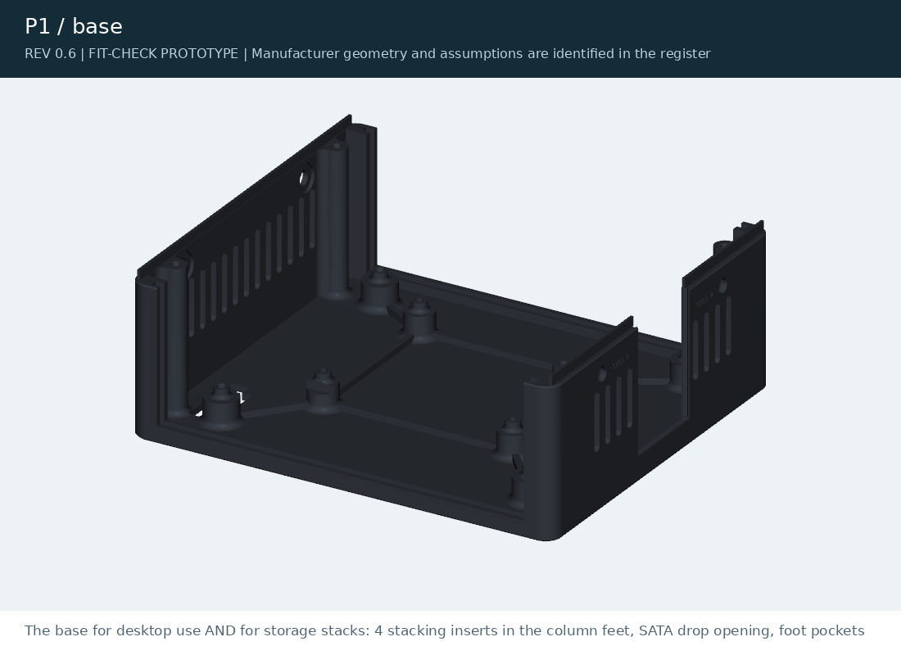</a> 
<b>P1 · Base</b> 
Qty 1 · 206 × 181 × 76 mm 
Desktop, or any setup with drive trays. Board supports, cooler columns, SATA floor opening. 
<b><a href="base.stl">3D view</a></b> · <a href="base.3mf?raw=true">3MF</a> · <a href="base.stl?raw=true">STL</a> · <a href="base.step?raw=true">STEP</a>
</td>
<td width="33%" valign="top">
<a href="cover.stl">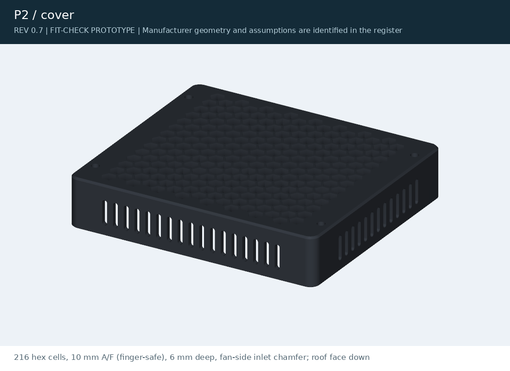</a> 
<b>P2 · Cover</b> 
Qty 1 · 206 × 181 × 25 mm 
Hex-grille lid. Captures the plates and hatch; 4 × M3 × 16 from the top. 
<b><a href="cover.stl">3D view</a></b> · <a href="cover.3mf?raw=true">3MF</a> · <a href="cover.stl?raw=true">STL</a> · <a href="cover.step?raw=true">STEP</a>
</td>
<td width="33%" valign="top">
<a href="front_gmsl.stl">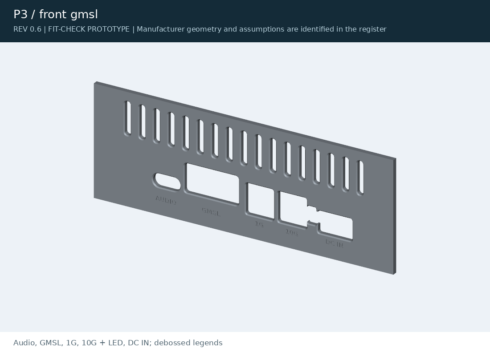</a> 
<b>P3 · Front plate, GMSL</b> 
Qty 1 of P3/P4 · 186 × 68 × 3 mm 
With the GMSL extension board: audio, GMSL, 1G, 10G, LED, DC IN. 
<b><a href="front_gmsl.stl">3D view</a></b> · <a href="front_gmsl.3mf?raw=true">3MF</a> · <a href="front_gmsl.stl?raw=true">STL</a> · <a href="front_gmsl.step?raw=true">STEP</a>
</td>
</tr>
<tr>
<td width="33%" valign="top">
<a href="front_no_gmsl.stl">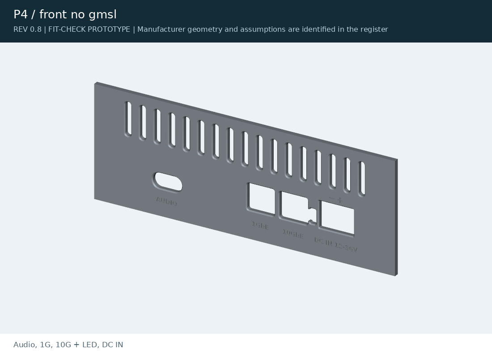</a> 
<b>P4 · Front plate</b> 
Qty 1 of P3/P4 · 186 × 68 × 3 mm 
Without the GMSL board: audio, 1G, 10G, LED, DC IN. 
<b><a href="front_no_gmsl.stl">3D view</a></b> · <a href="front_no_gmsl.3mf?raw=true">3MF</a> · <a href="front_no_gmsl.stl?raw=true">STL</a> · <a href="front_no_gmsl.step?raw=true">STEP</a>
</td>
<td width="33%" valign="top">
<a href="rear_io.stl">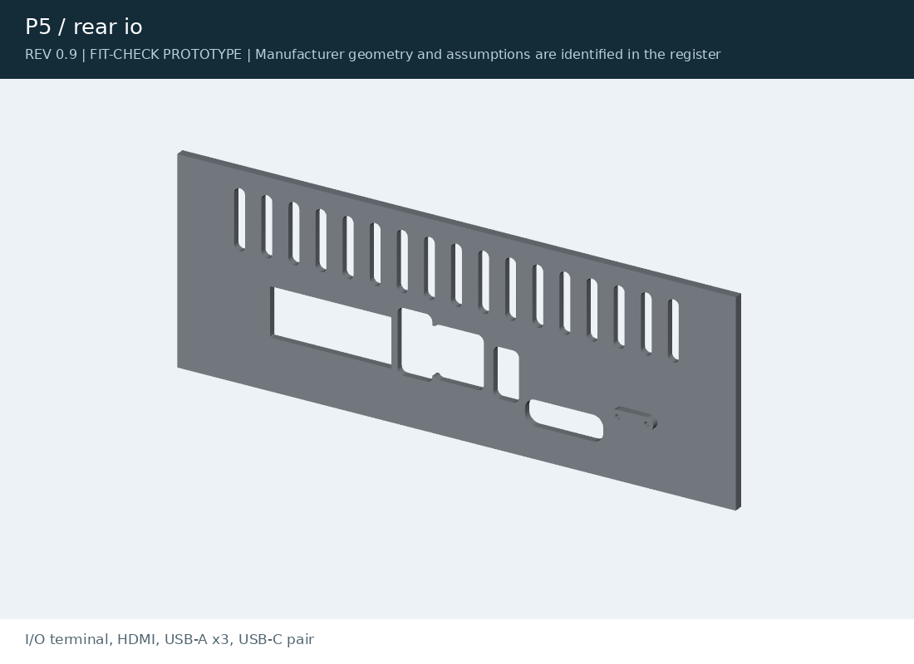</a> 
<b>P5 · Rear plate</b> 
Qty 1 · 186 × 68 × 5 mm 
I/O terminal, HDMI, 3 × USB-A, 2 × USB-C. 
<b><a href="rear_io.stl">3D view</a></b> · <a href="rear_io.3mf?raw=true">3MF</a> · <a href="rear_io.stl?raw=true">STL</a> · <a href="rear_io.step?raw=true">STEP</a>
</td>
<td width="33%" valign="top">
<a href="side_hatch.stl">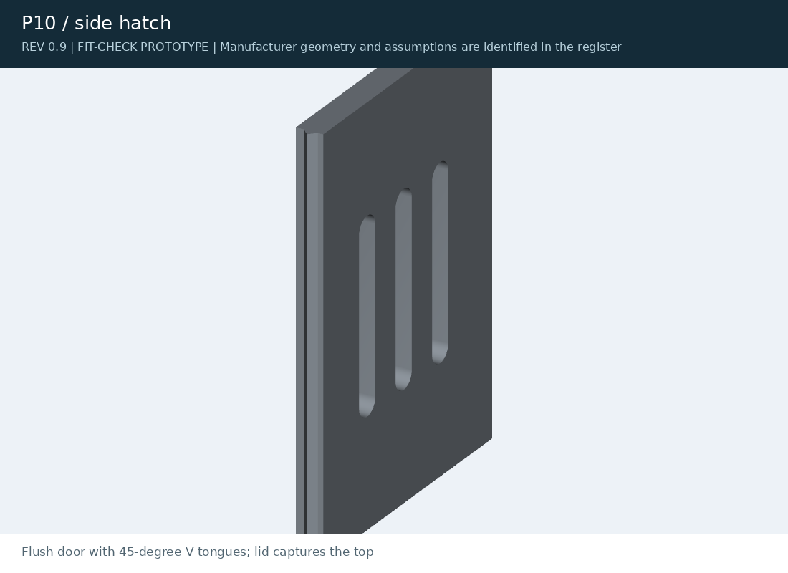</a> 
<b>P10 · Side hatch</b> 
Qty 1 · 61 × 44 × 4 mm 
Flush door over the J17 header; the lid holds it in. 
<b><a href="side_hatch.stl">3D view</a></b> · <a href="side_hatch.3mf?raw=true">3MF</a> · <a href="side_hatch.stl?raw=true">STL</a> · <a href="side_hatch.step?raw=true">STEP</a>
</td>
</tr>
</table>

## Mounting and closures

Depends on how the enclosure is mounted and whether drive trays are fitted.

<table>
<tr>
<td width="33%" valign="top">
<a href="base_mount.stl">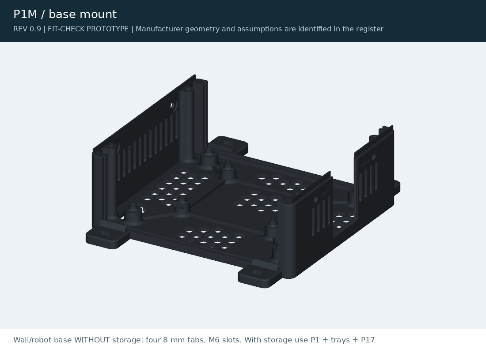</a> 
<b>P1M · Base with mounting tabs</b> 
Qty 0–1 · 233 × 206 × 76 mm 
Replaces P1 for a wall or robot mount <b>without</b> drive trays. Four M6 slots. 
<b><a href="base_mount.stl">3D view</a></b> · <a href="base_mount.3mf?raw=true">3MF</a> · <a href="base_mount.stl?raw=true">STL</a> · <a href="base_mount.step?raw=true">STEP</a>
</td>
<td width="33%" valign="top">
<a href="storage_mount_plate.stl">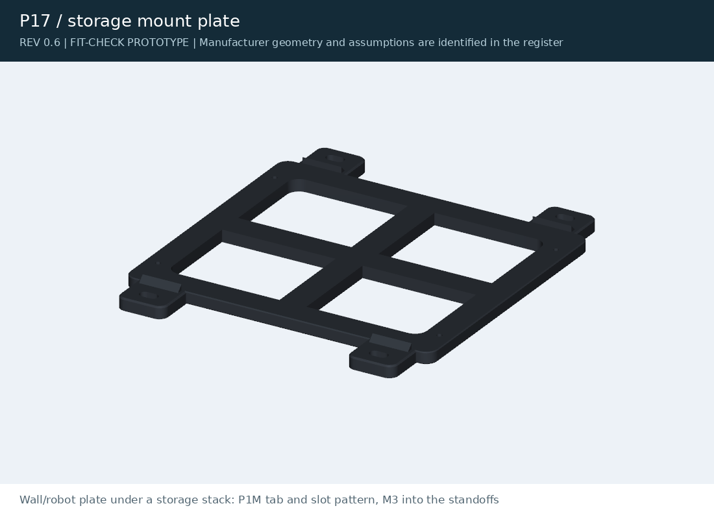</a> 
<b>P17 · Mounting plate</b> 
Qty 0–1 · 233 × 206 × 12 mm 
Wall or robot mount <b>under</b> a drive-tray stack, with the same tab pattern as P1M. 
<b><a href="storage_mount_plate.stl">3D view</a></b> · <a href="storage_mount_plate.3mf?raw=true">3MF</a> · <a href="storage_mount_plate.stl?raw=true">STL</a> · <a href="storage_mount_plate.step?raw=true">STEP</a>
</td>
<td width="33%" valign="top">
<a href="chimney_cap.stl">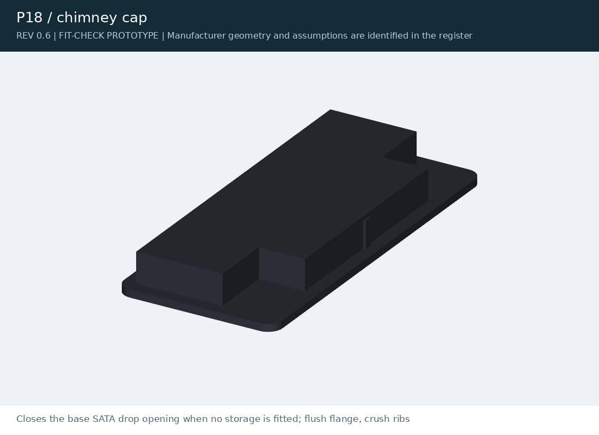</a> 
<b>P18 · Floor cap</b> 
Qty 0–1 · 37 × 16 × 4 mm 
Plugs the SATA cable opening in the floor when no trays are fitted. 
<b><a href="chimney_cap.stl">3D view</a></b> · <a href="chimney_cap.3mf?raw=true">3MF</a> · <a href="chimney_cap.stl?raw=true">STL</a> · <a href="chimney_cap.step?raw=true">STEP</a>
</td>
</tr>
</table>

## Drive storage

Optional. Stack 1 tray, 1 of each or 2 of each, in any order, under P1.

<table>
<tr>
<td width="33%" valign="top">
<a href="storage_35.stl">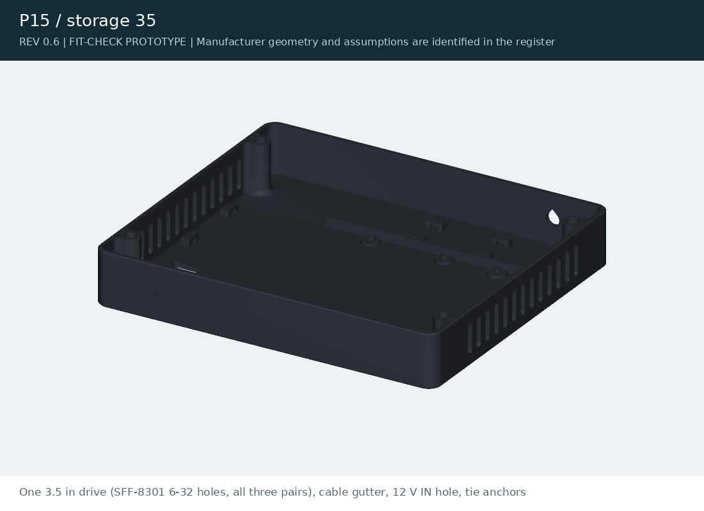</a> 
<b>P15 · 3.5 in tray</b> 
Qty 0–2 · 206 × 181 × 32 mm 
One 3.5 in drive. Needs its own 12 V supply (12V IN hole). 
<b><a href="storage_35.stl">3D view</a></b> · <a href="storage_35.3mf?raw=true">3MF</a> · <a href="storage_35.stl?raw=true">STL</a> · <a href="storage_35.step?raw=true">STEP</a>
</td>
<td width="33%" valign="top">
<a href="storage_25.stl">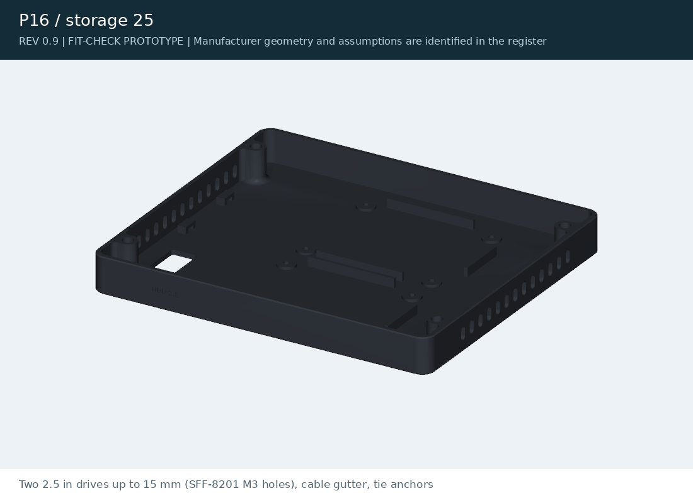</a> 
<b>P16 · 2.5 in tray</b> 
Qty 0–2 · 206 × 181 × 22 mm 
Two 2.5 in drives up to 15 mm thick, powered from the board. 
<b><a href="storage_25.stl">3D view</a></b> · <a href="storage_25.3mf?raw=true">3MF</a> · <a href="storage_25.stl?raw=true">STL</a> · <a href="storage_25.step?raw=true">STEP</a>
</td>
<td width="33%" valign="top">
<a href="ssd_clip.stl">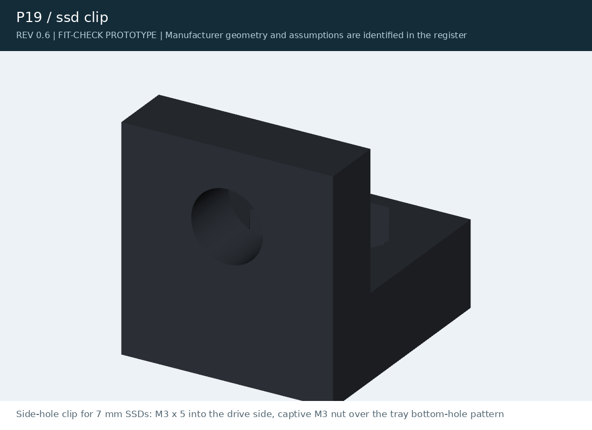</a> 
<b>P19 · SSD clip</b> 
Qty 4 per drive · 11 × 10 × 10 mm 
Holds a 7 mm SSD that has side holes only. 
<b><a href="ssd_clip.stl">3D view</a></b> · <a href="ssd_clip.3mf?raw=true">3MF</a> · <a href="ssd_clip.stl?raw=true">STL</a> · <a href="ssd_clip.step?raw=true">STEP</a>
</td>
</tr>
</table>

## Jigs, fixtures and test coupons

<b>Print these first</b>, in the filament you will use for the enclosure. They are small and check the fits that depend on your printer.

<table>
<tr>
<td width="33%" valign="top">
<a href="mount_fit_template.stl">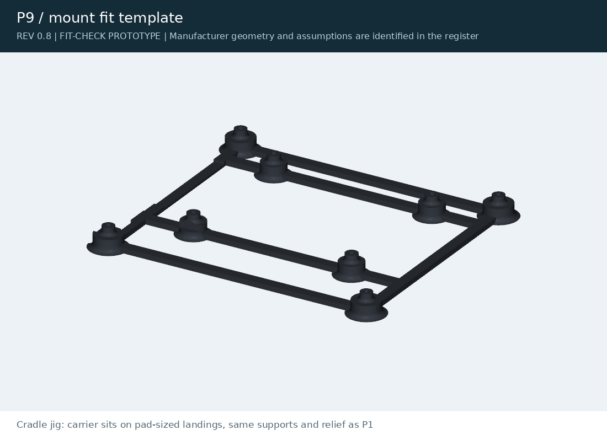</a> 
<b>P9 · Board fit template</b> 
Qty 1 · 172 × 152 × 12 mm 
Jig: set the bare board on it. Every pad should touch, and the cooler holes should line up. 
<b><a href="mount_fit_template.stl">3D view</a></b> · <a href="mount_fit_template.3mf?raw=true">3MF</a> · <a href="mount_fit_template.stl?raw=true">STL</a> · <a href="mount_fit_template.step?raw=true">STEP</a>
</td>
<td width="33%" valign="top">
<a href="m3_insert_coupon.stl">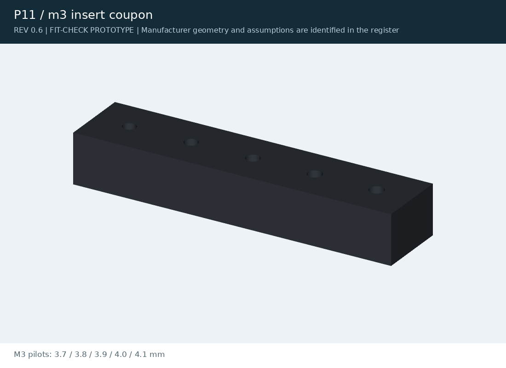</a> 
<b>P11 · Insert coupon</b> 
Qty 1 · 90 × 20 × 14 mm 
Five pilot holes, 3.7–4.1 mm. Use the one that holds an M3 insert best. 
<b><a href="m3_insert_coupon.stl">3D view</a></b> · <a href="m3_insert_coupon.3mf?raw=true">3MF</a> · <a href="m3_insert_coupon.stl?raw=true">STL</a> · <a href="m3_insert_coupon.step?raw=true">STEP</a>
</td>
<td width="33%" valign="top">
<a href="rail_coupon.stl">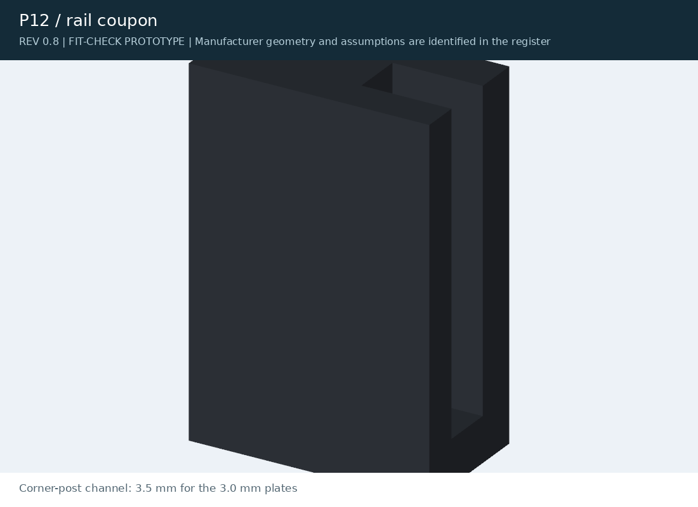</a> 
<b>P12 · Rail coupon</b> 
Qty 1 · 24 × 16 × 9 mm 
A short length of the plate channel. Test with P13. 
<b><a href="rail_coupon.stl">3D view</a></b> · <a href="rail_coupon.3mf?raw=true">3MF</a> · <a href="rail_coupon.stl?raw=true">STL</a> · <a href="rail_coupon.step?raw=true">STEP</a>
</td>
</tr>
<tr>
<td width="33%" valign="top">
<a href="rail_key.stl">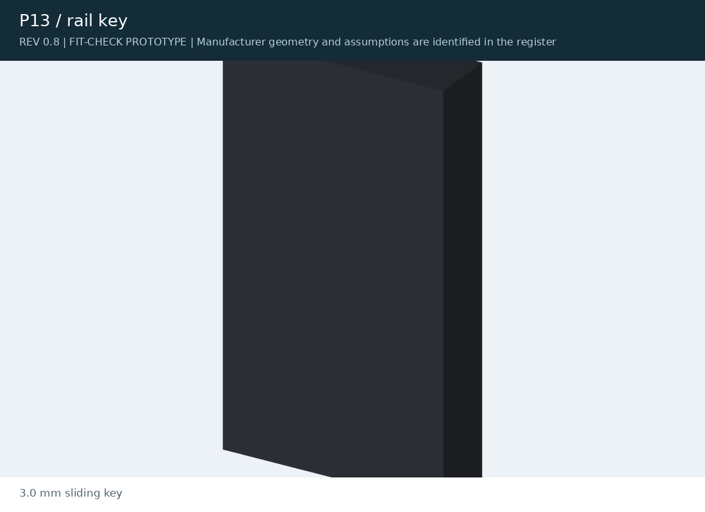</a> 
<b>P13 · Rail key</b> 
Qty 1 · 18 × 10 × 3 mm 
Should slide in P12 without rattling. 
<b><a href="rail_key.stl">3D view</a></b> · <a href="rail_key.3mf?raw=true">3MF</a> · <a href="rail_key.stl?raw=true">STL</a> · <a href="rail_key.step?raw=true">STEP</a>
</td>
<td width="33%" valign="top">
<a href="countersink_coupon.stl">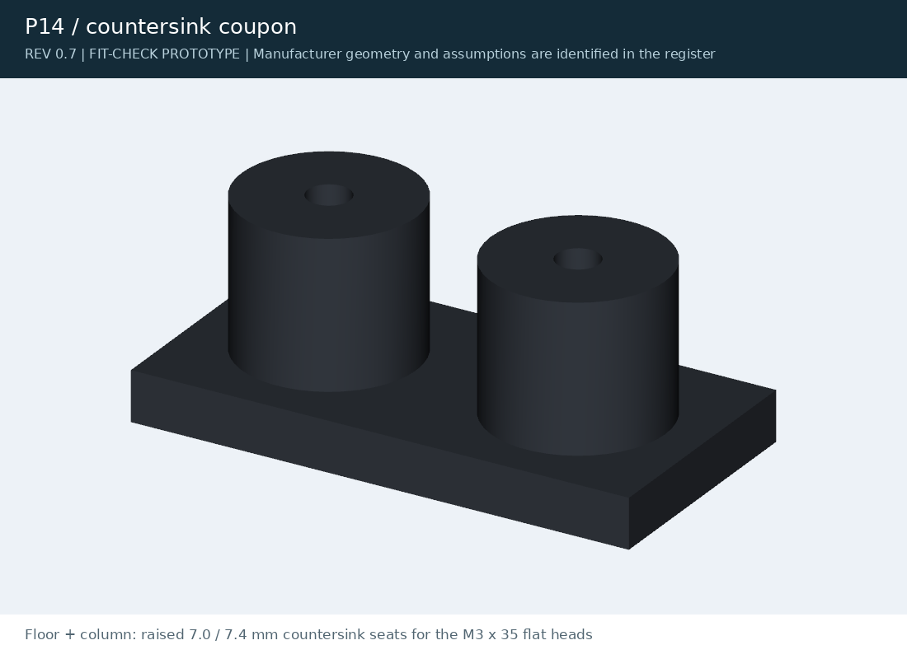</a> 
<b>P14 · Countersink coupon</b> 
Qty 1 · 40 × 20 × 17 mm 
An M3 × 35 flat head should sit flush on its cone. 
<b><a href="countersink_coupon.stl">3D view</a></b> · <a href="countersink_coupon.3mf?raw=true">3MF</a> · <a href="countersink_coupon.stl?raw=true">STL</a> · <a href="countersink_coupon.step?raw=true">STEP</a>
</td>
<td width="33%" valign="top">
<a href="rpsma_coupon.stl">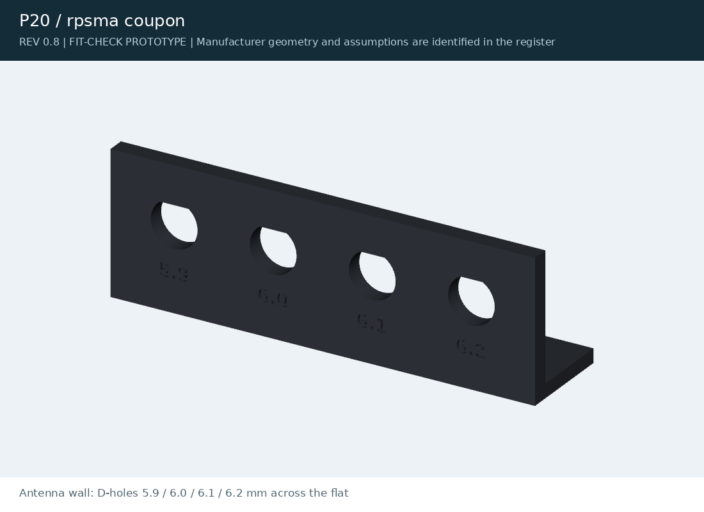</a> 
<b>P20 · Antenna hole coupon</b> 
Qty 1 · 60 × 20 × 14 mm 
Four D-holes, 5.9–6.2 mm across the flat. Use the tightest one an RP-SMA bulkhead pushes into without turning. 
<b><a href="rpsma_coupon.stl">3D view</a></b> · <a href="rpsma_coupon.3mf?raw=true">3MF</a> · <a href="rpsma_coupon.stl?raw=true">STL</a> · <a href="rpsma_coupon.step?raw=true">STEP</a>
</td>
</tr>
</table>

## Other files in this folder

The design pipeline (`cad-agent all`) writes these. You don't need them for printing.

| File | What it is |
|---|---|
| `j501-agx-rev09-fit-check-manifest.json` | sha256 of every file from the last pipeline run; CI checks the print files against it |
| `review-validation.json` | Pass or fail for every design check |
| `geometry-checks.json`, `print-review.json` | Per-part geometry and printability checks |
| `assembly-checks.json`, `assembly-paths.json`, `mount-checks.json` | Assembly order, plate insertion paths, mounting tabs |
| `carrier-clearances.json`, `shell-clearances.json`, `storage-checks.json` | Clearances to the board, its connectors and the drive trays |
| `design-metrics.json` | Measured dimensions and design calculations |
| `cad-agent-results.json` | Summary of the pipeline run |

Assemblies that include the carrier board and the NVIDIA module are built locally but not committed, because we can't redistribute the vendor models.
