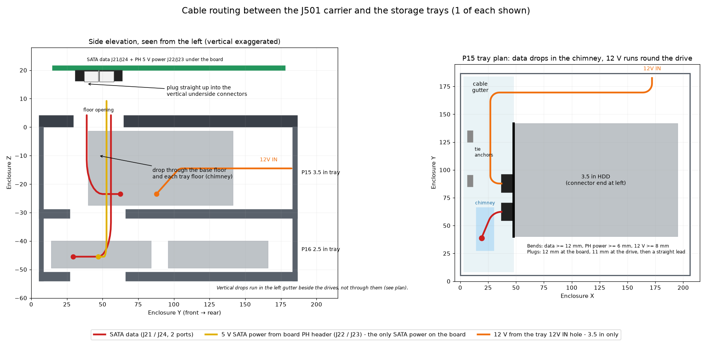
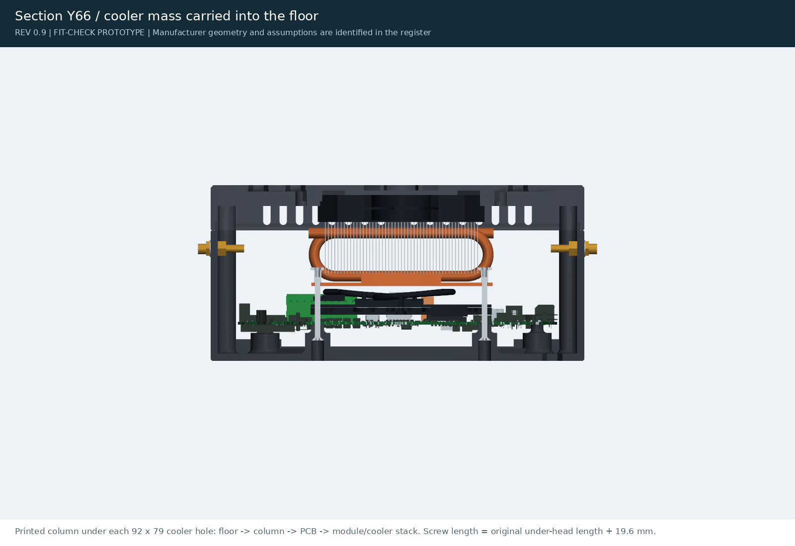

[J501 AGX Orin](../README.md) / **tools**

# Tools

Scripts that check, render, document and package the design. [`cad-agent.yaml`](../cad-agent.yaml) runs them in order
(`cad-agent all`); without the toolkit, run the scripts in the table below in that order with `.venv/bin/python`.

<table>
<tr>
<td width="33%" valign="top"> <b>cable_diagram.py</b>: cable-route diagram</td>
<td width="33%" valign="top"> <b>render.py</b>: renders for <code>preview/</code></td>
<td width="33%" valign="top"> <b>render_steps.py</b>: assembly step pictures</td>
</tr>
</table>

## The pipeline, in order

| Step | Script | Writes |
|---|---|---|
| build | [`../cad/build.py`](../cad/build.py) | Print files in `exports/` |
| clearances | [`check_clearances.py`](check_clearances.py) | `exports/carrier-clearances.json`: plastic against the board and hardware |
| shells | [`check_shells.py`](check_shells.py) | `exports/shell-clearances.json`: plastic against the board's open surface shells |
| assembly-paths | [`assembly_paths.py`](assembly_paths.py) | `exports/assembly-paths.json`: each plate can slide into place |
| print-review | [`print_review.py`](print_review.py) | `exports/geometry-checks.json`, `exports/print-review.json`: watertight, fits the bed, overhangs |
| design-metrics | [`design_metrics.py`](design_metrics.py) | `exports/design-metrics.json`: measured dimensions and design calculations |
| mounts | [`check_mounts.py`](check_mounts.py) | `exports/mount-checks.json`: mounting tabs, washer support and driver access |
| cooler-study | [`cooler_fit_review.py`](cooler_fit_review.py) | `exports/cooler-study/`: cooler component STEPs and the lid fit report ([cooler fit review](../docs/cooler-fit-review.md)) |
| view | [`view_model.py`](view_model.py) | `exports/view/` (local only): one 3D viewer with the printed parts, cooler, carrier board, module and screws as sections |
| storage | [`check_storage.py`](check_storage.py) | `exports/storage-checks.json`: trays, cable routes, bend radii, underside slots |
| cable-diagram | [`cable_diagram.py`](cable_diagram.py) | `preview/cable-route-diagram.png` |
| docs | [`write_docs.py`](write_docs.py) | The tables in `docs/` and `docs/engineering-review.html` |
| check-sheet | [`check_sheet.py`](check_sheet.py) | `docs/check-sheet.pdf` |
| detailed-assembly | [`detailed_assembly.py`](detailed_assembly.py) | Full assemblies with the vendor models (local only, not committed) |
| render | [`render.py`](render.py) | Every picture in `preview/` |
| assembly-steps | [`render_steps.py`](render_steps.py) | `docs/assembly/*.png` |
| readmes | [`write_readmes.py`](write_readmes.py) | A `README.md` with pictures in every folder, including the print index in `exports/` |
| validate | [`validate_review.py`](validate_review.py) | `exports/review-validation.json`: every check passed, every link resolves |

`cad-agent` also writes the 3MF files and the manifest. [`export_3mf.py`](export_3mf.py) does the 3MF step on its own.

## Other scripts

| Script | What it does |
|---|---|
| [`fetch_references.py`](fetch_references.py) | Downloads the vendor models and datasheets in `references/sources.json`, checks their sha256, and rebuilds the caches |
| [`inspect_reference.py`](inspect_reference.py) | Lists the solids in the carrier board model (`references/solids.json`) |
| [`extract_measurements.py`](extract_measurements.py) | Measures the PCB outline, holes and edge components from the board model |
| [`extract_features.py`](extract_features.py) | Pulls the mounting features out of the board model |
| [`measure_pcb_holes.py`](measure_pcb_holes.py) | Fits the PCB holes (`references/pcb-hole-fits.json`) |
| [`export_hardware.py`](export_hardware.py) | Writes connector meshes to `references/hardware/` |
| [`export_open_shells.py`](export_open_shells.py) | Writes the board's open surface shells for the shell check |
| [`renderkit.py`](renderkit.py) | Shared VTK helpers for `render.py` and `render_steps.py` |
| [`serve_preview.py`](serve_preview.py) | Serves the local review site ([`preview/index.html`](../preview/index.html)) |
| [`package_release.py`](package_release.py) | Builds the print zip and release notes |
| [`ci_check.py`](ci_check.py) | What CI runs: print files match the manifest, every check passed, STLs are sound, README links resolve |
| [`thermal.py`](thermal.py) | Airflow and heat in OpenFOAM (hours): the bare module, and the cooler at 40 W (`exports/thermal/`) |
| [`thermal_figures.py`](thermal_figures.py) | Sections, streamlines and videos of each finished CFD case (`preview/thermal/`) |
| [`lid_sweep.py`](lid_sweep.py) | Lid study: roof, ribs and fan grille variants under 300 N; picks the lightest passing lid |
| [`lid_riser.py`](lid_riser.py) | One-off riser that lifts an already printed cover over a taller cooler or fan (not a release part) |
